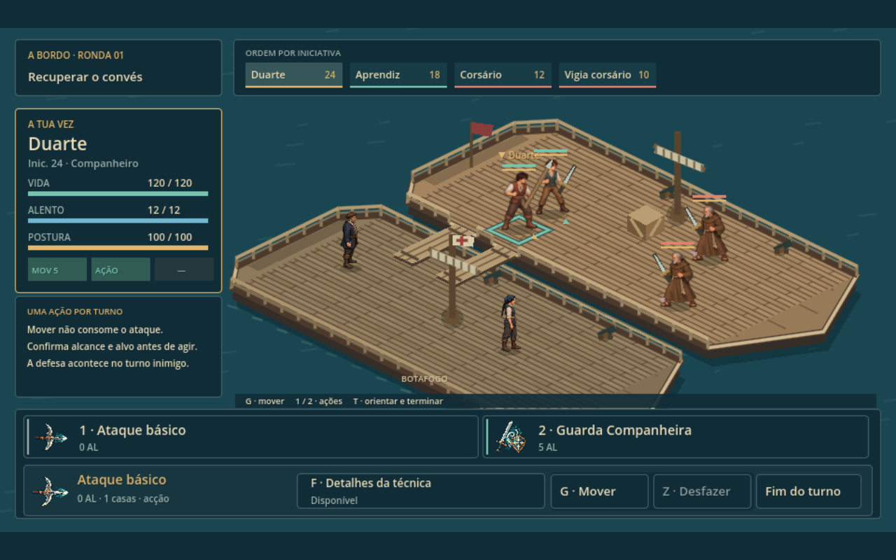
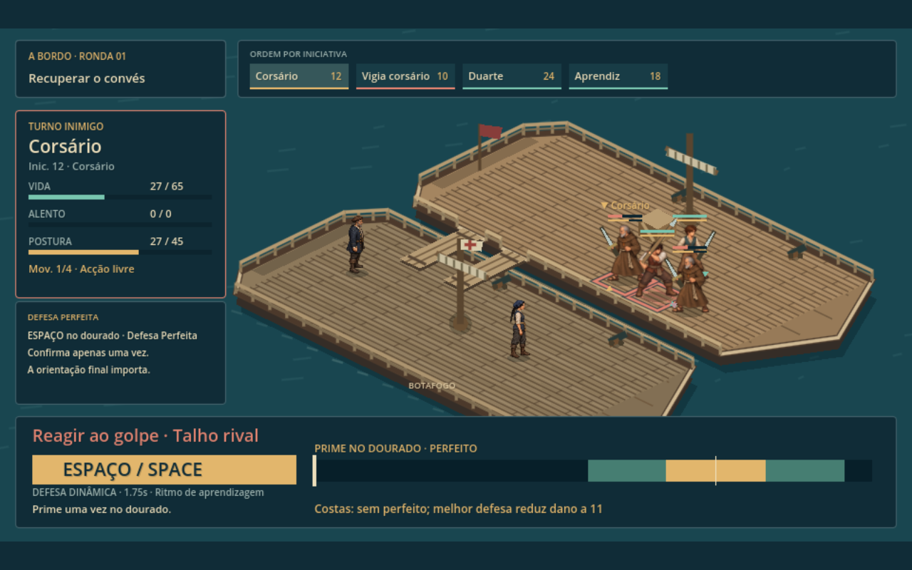

# Abordagem — o combate de Portugal no convés

Revisão após o jogador relatar que a abordagem parecia outro combate e que o cenário estava esticado. A luta acontece **apenas no convés inimigo**, com a Botafogo visível ao lado, conforme a disposição escolhida pelo jogador. Comandos, técnicas, timing, movimento e apresentação vêm do combate de Portugal.

## Dois conveses, mesma escala de Portugal

O antigo convés de 9×8 casas formava uma superfície muito larga, com uma proa vazia e quase todo o segundo barco escondido. Agora são dois cascos paralelos, separados por água e ligados por duas pranchas. A Botafogo tem tripulação, mastro e bandeira visíveis; o navio inimigo concentra os combatentes.

A área jogável tem **9×4 casas**, mantendo exatamente a projeção, o tamanho das casas e a altura dos personagens do combate em terra. Não houve compressão de sprites ou da interface para encaixar os barcos. Costados, amuradas, tábuas e plataformas externas dão volume ao cenário; mastro e carga correspondem aos obstáculos da luta.

O grupo já começa no convés inimigo. Movimento, caminhos, alcance de ataques, seleção pelo mouse e cursor do teclado respeitam a amurada. A Botafogo e as pranchas compõem a cena e não são destinos de combate.

Todos os lutadores agora usam os atlas completos do combate de Portugal: caminhada, ataque, defesa, reação e queda, com os mesmos apoios dos pés e pontos de empunhadura. Os corsários reutilizam provisoriamente a arte de combate de Tomé; a versão anterior adaptava um sprite de exploração sem a sequência completa de golpes. Rodrigo e Beatriz aparecem como tripulação no outro navio.

## Diferenças corrigidas

A integração anterior usava a base de Portugal, mas substituía partes importantes: a técnica de cada manejo virava um ataque genérico com dano extra; a guarda de Duarte vinha de outro catálogo; o modo da abordagem desativava as passivas da campanha; o timing da defesa mudava de ritmo; atributos do protagonista eram sobrescritos. Duarte também herdava movimento zero do espaço reservado ao companheiro ausente dos treinos.

Agora as definições comuns vêm de `campaign_rules.gd`, sem versões paralelas das técnicas na abordagem:

- básico e técnica do manejo mantêm potência, custo, alcance, forma e efeito de Portugal;
- lança continua exigindo a distância certa; arma de fogo exige alinhamento; machado prepara o personagem em vez de virar outro ataque de dano;
- passivas equipadas voltam a funcionar, incluindo o desconto de Treino Paciente;
- Duarte tem cinco pontos de movimento, ataque básico e **Guarda Companheira**, com custo e desconto próprios e interceptação de **60% para o protegido / 40% para Duarte**;
- comandos só oferecem o que foi aprendido; Defesa Perfeita respeita o desbloqueio;
- o combate conserva movimento antes/depois da ação, orientação, previsão, confirmação, timing, impacto e recuperação de Portugal.

A interface, ícones, barras de postura, poses, efeitos e controles permanecem os de Portugal. O enquadramento usa o mesmo viewport de 960×540, com ampliação uniforme para preservar as proporções.

## Testar diretamente

No menu inicial, escolher **Testar abordagem · combate no convés**. Entra diretamente na luta com um kit preparado do final de Portugal, sem precisar navegar ou vencer primeiro os canhões. O teste não grava por cima da campanha nem das viagens. Ao vencer, regressa à navegação.

**G** abre movimento; clique escolhe a casa; **Enter** confirma. **1/2** selecionam básico e técnica/apoio. **Espaço** confirma o timing. **T** escolhe orientação e fim do turno; **Q/E** orientam; **Z** desfaz movimento quando permitido. O comando usa os mesmos atalhos de Portugal.

Na viagem da campanha, a preparação é uma cópia dos equipamentos, atributos, aprendizado e passivas do personagem. Essa cópia fica no save marítimo, para continuar a viagem sem perder o kit ao reiniciar o jogo. Saves marítimos antigos continuam aceitos e recuperam a preparação do checkpoint de Portugal, por leitura, sem carregar outra cena ou alterar os perfis vivos. Dados inválidos são rejeitados antes de mudar a viagem. Os inimigos, posições, obstáculos e condições de vitória são próprios da abordagem; a luta só termina com a derrota de uma das equipes.

## Validação

`tests/boarding.gd` compara os cinco manejos diretamente com as definições de Portugal, executa básico/recuperação/desconto, confere guarda e aprendizado, testa equipamento salvo e migração, usa teclado/clique para mover e percorre uma batalha completa com cada manejo. Também confere que o personagem da campanha e seus saves ficam preservados.

Resultado desta revisão: **65 verificações headless e 67 em OpenGL**, sem falhas. Incluem contenção de todas as casas no convés, bloqueio do mar e do navio aliado, contorno de alcance, limite do cursor e proporções reais da janela em 1600×900 e 1024×768. Regressões repetidas após a mudança: **36** de resposta/animação e **88** de navegação, todas aprovadas.

Na revisão anterior das regras também passaram 19 verificações de passivas, 31 do capítulo completo e 23 do menu. Capturas reais em OpenGL acima. A arte dos corsários ainda é reutilizada; as técnicas, regras e animações já são compartilhadas com o combate em terra.

Arquivos principais: `campaign_rules.gd`, `portugal_rules.gd`, `portugal_view.gd`; `scripts/navigation/boarding_rules.gd`, `boarding_layout.gd`, `boarding_loadout.gd`, `boarding_view.gd`, `boarding_arena.gd`, `boarding_field.gd`, `voyage.gd` e `voyage_model.gd`. Os módulos de referência em `mar_de_ferro/` não foram alterados.
