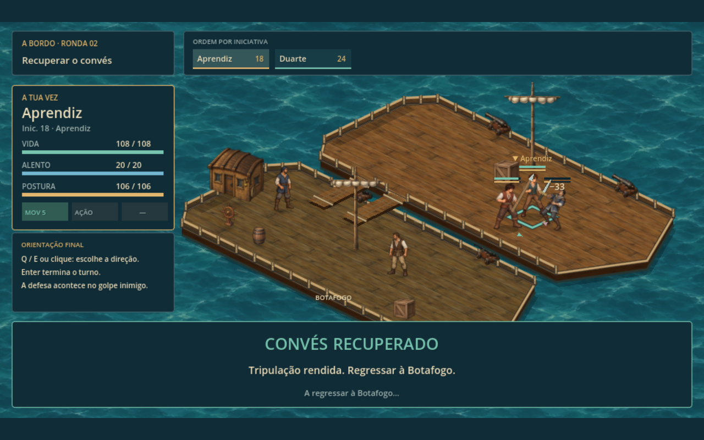
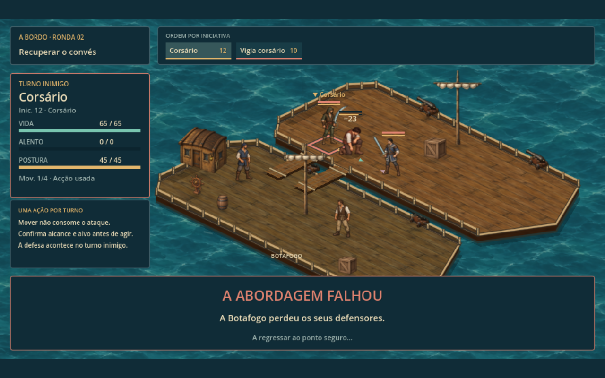

# Batalha no convés — arte de Mar de Ferro e combate de Portugal

A abordagem acontece **no convés inimigo**, com a Botafogo e sua tripulação visíveis ao lado. A apresentação usa os recursos ilustrados de **Mar de Ferro**, conforme solicitado pelo jogador, e conserva as regras, os comandos e a escala do combate de Portugal.

[Ver a batalha completa com áudio — 25,93 segundos](boarding-mar-de-ferro.mp4). A gravação percorre o atalho do menu, movimento, quatro ataques, dois timings defensivos, resultado e retorno ao mar pelos controles reais.

## Testar

No menu inicial, escolher **Testar abordagem · combate no convés**. O grupo entra com um kit preparado do final de Portugal. O atalho não grava por cima da campanha nem das viagens.

- **G:** mover; clique escolhe a casa; **Enter** confirma.
- **1/2:** básico e técnica do protagonista, ou apoio de Duarte.
- **Espaço:** confirmar o timing ofensivo ou defensivo.
- **T:** orientar e terminar; **Q/E:** mudar a orientação.
- **Z:** desfazer movimento quando permitido.

## Arte e proporções

Foram copiados **14 recursos PNG/SVG de Mar de Ferro, byte por byte**, para `assets/art/combat/boarding/`. A origem e o SHA-256 de cada arquivo estão em [reused-assets.json](../assets/art/combat/boarding/reused-assets.json). O projeto de origem não foi modificado. `tools/prepare_boarding_assets.py` reproduz a cópia e mede os metadados sem reescrever os pixels das fontes.

| Elemento | Recurso utilizado |
|---|---|
| Protagonista e Duarte | Atlas de combate já usados em Portugal, preservando suas identidades. |
| Corsário | `rogue-illustrated-strip.png`, com sabre e empunhaduras de Mar de Ferro. |
| Vigia corsário | `guard-illustrated-strip.png`, com espada e empunhaduras de Mar de Ferro. |
| Tripulação da Botafogo | Marinheiro e trabalhador ilustrados de Mar de Ferro, desarmados e fora da simulação de combate. |
| Piso e água | Materiais pintados `regional-deck.png` e `regional-water-illustrated-v1.png`. |
| Objetos | Cabine, vela recolhida, leme, canhão, barril e caixa ilustrados de Mar de Ferro. |

Os dois adversários têm silhuetas diferentes. Seus atlas conservam os **seis quadros originais**: parado, dois passos, preparação, extensão e reação. A defesa usa a pose de preparação; a rendição usa a reação, com a arma recolhida. Não são anunciadas poses novas que não existam nas fontes. A tripulação civil usa somente parado/caminhada, sem animações de combate.

Pivôs dos pés e empunhaduras são medidos por quadro. As mãos originais cobrem os punhos das armas. Texturas mantêm transparência, preenchimento das bordas alfa e mipmaps, no mesmo tratamento suave usado em Mar de Ferro. A variação visual do corpo conserva escala uniforme.

O convés tem **9×4 casas**, com a mesma origem e passos de projeção do combate de Portugal: `(590,134)` e `(34,16.5)`. Os personagens conservam a altura do combate em terra: 60 unidades para adultos e 63 para Duarte. Piso e água repetem os materiais em escala própria; objetos verticais conservam a proporção da fonte. Mastro e carga são ordenados com os personagens pela base. Objetos altos ficam translúcidos quando encobrem um combatente.

A Botafogo e o navio inimigo têm costados, amuradas, aberturas e duas pranchas visíveis. O grupo já começa depois da travessia. Movimento, caminhos, alcance de ataque e cursor do teclado ficam contidos no convés inimigo. O navio aliado é cenário e não recebe alvos ou destinos de combate.

O viewport de 960×540 recebe ampliação uniforme para diferentes formatos de janela. Interface, ícones, barras de postura, efeitos, marcações e controles continuam os de Portugal.

## Regras e encerramento

As técnicas vêm de `campaign_rules.gd`, compartilhadas com Portugal:

- básico e técnica de cada manejo conservam potência, custo, alcance, forma e efeito;
- lança mantém a distância exata; arma de fogo exige alinhamento; machado prepara o personagem;
- passivas equipadas funcionam, incluindo o desconto de Treino Paciente;
- Duarte tem cinco pontos de movimento e Guarda Companheira, com custo próprio e interceptação de 60% para o protegido / 40% para Duarte;
- comandos e Defesa Perfeita respeitam o aprendizado da campanha;
- movimento antes/depois da ação, orientação, previsão, confirmação, timing, impacto e recuperação seguem o combate em terra.

A viagem da campanha usa uma cópia dos equipamentos, atributos, aprendizado e passivas do protagonista. Esse kit fica no save marítimo. Saves antigos continuam aceitos e recuperam a preparação do checkpoint de Portugal por leitura, sem alterar o perfil vivo.

A vitória mostra **Convés recuperado**, conclui a recuperação do último golpe e regressa à navegação com a recompensa do encontro. A derrota mostra **A abordagem falhou**, abre a recuperação da viagem e preserva o último ponto seguro. O encerramento usa cobertura e emite a conclusão uma única vez.

## Validação

`tests/boarding.gd`: **78 verificações headless e 80 em OpenGL**, sem falhas. Cobrem os cinco manejos, batalha completa com cada um, técnicas/passivas, guarda, equipamento, migração, movimento por teclado/clique, restrições de área, proporções em 1600×900 e 1024×768, origem e transparência da arte, seleção de poses, vitória, derrota e preservação dos checkpoints.

Regressões desta entrega: **88 verificações de navegação** e **19 da apresentação do combate normal**, sem falhas. A comparação de arquivos confirmou as 14 cópias idênticas à origem.

`tools/record_boarding.gd` gravou uma batalha completa de 778 quadros a 30 fps, em 1280×800, pelos eventos reais de teclado e mouse. O vídeo possui áudio estéreo de 48 kHz; pico medido de −17,1 dBFS. A revisão visual examinou início, deslocamento, ataques, defesa, vitória, derrota e retorno à navegação. O AVI intermediário foi removido; o MP4 é a prévia para revisão.

Arquivos da integração: `boarding_assets.gd`, `boarding_actor_art.gd`, `boarding_arena.gd`, `boarding_layout.gd`, `boarding_view.gd`, `boarding_field.gd`, `boarding_rules.gd`, `boarding_loadout.gd` e `boarding_ending.gd`, em `scripts/navigation/`. Os módulos de referência em `scripts/combat/mar_de_ferro/` permanecem intactos.
