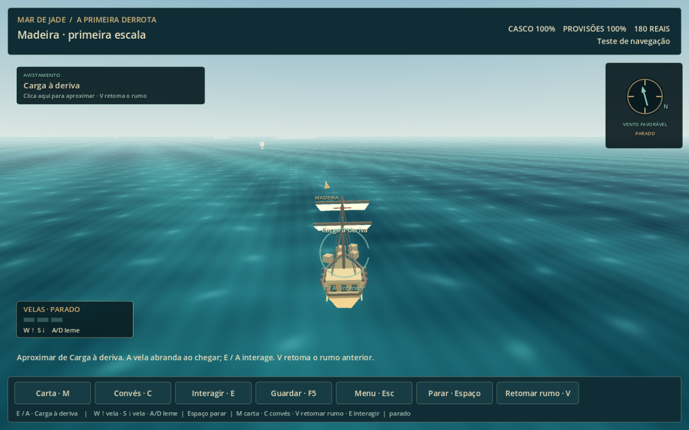
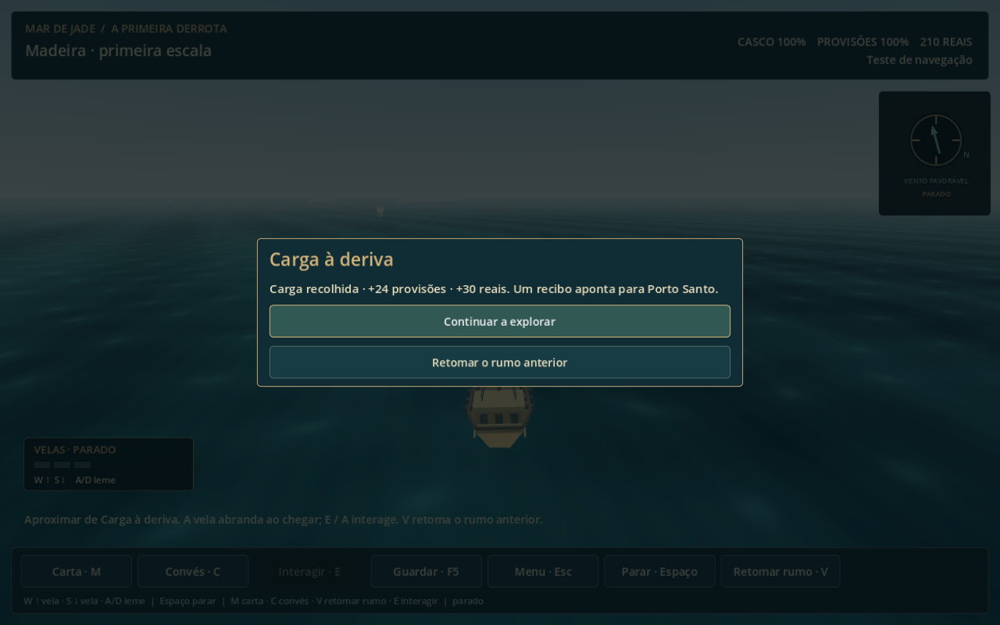
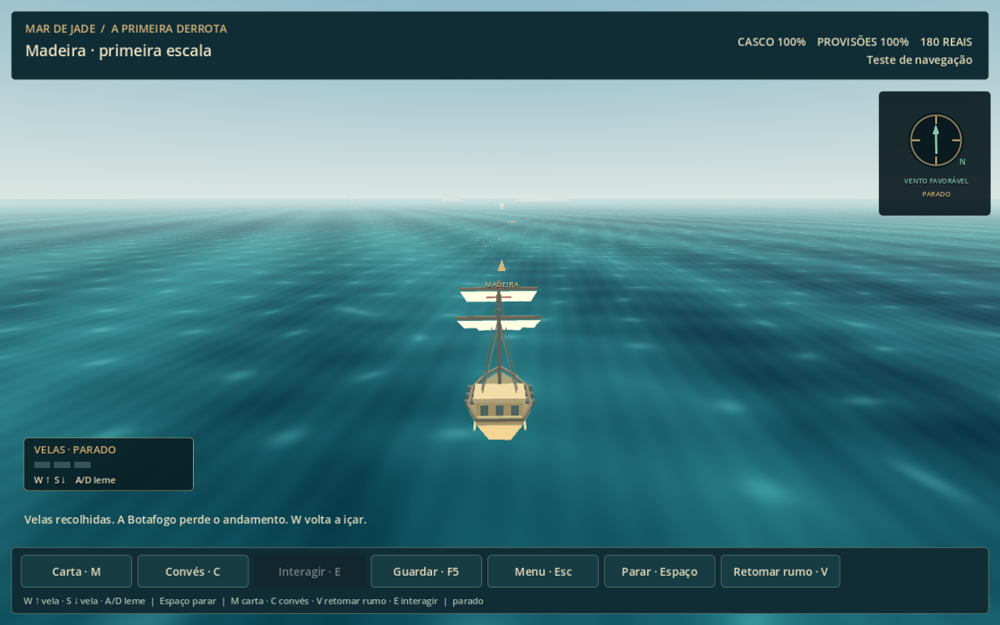
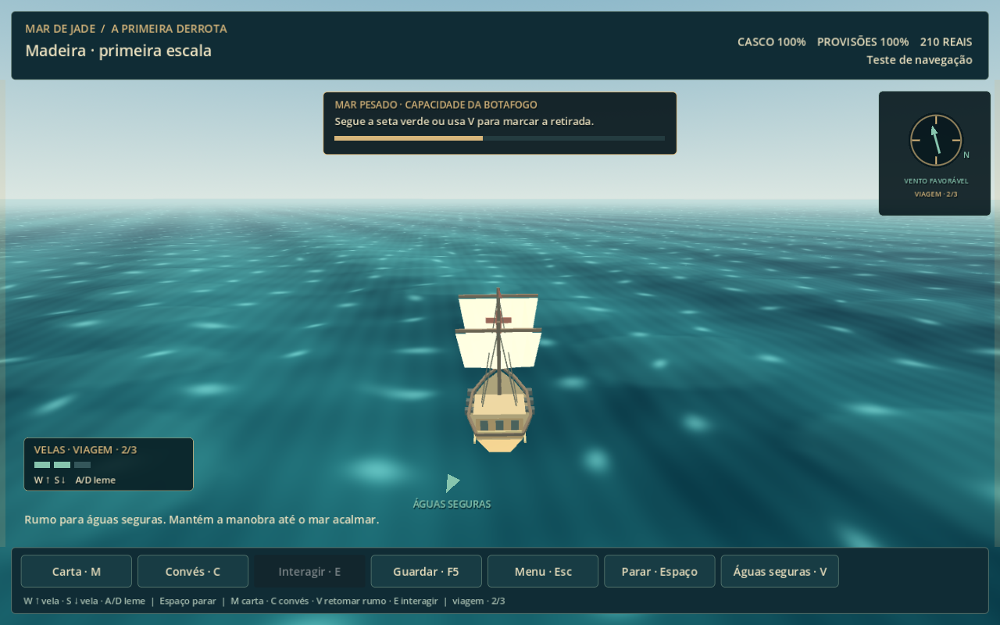

# Navegação — refinamento do primeiro percurso

Implementado em 15/10/2026 após a primeira versão Lisboa–Madeira. O acesso continua no menu inicial em **Testar navegação · Lisboa → Madeira**. Os salvamentos anteriores continuam compatíveis.

Registro do refinamento anterior. O playtest seguinte substituiu a condução absoluta e o controle de meia vela por [leme relativo, três velas e câmera com horizonte](navegacao-camera-e-leme.md); os controles e medições abaixo descrevem a etapa anterior.

## Avistar, desviar, descobrir e retomar

O percurso tem oito sinais ambientais distribuídos, ligados a encontros existentes: aves indicam algo na água, uma trilha de madeira conduz à carga ou ao náufrago, e correntes ajudam a reconhecer passagens e costas. Aproximar-se gera um relato do vigia/piloto uma única vez. Ver o sinal não preenche o mapa automaticamente.

Avistamentos têm uma indicação na direção correspondente e um cartão clicável. Clicar no objeto ou no cartão marca a aproximação, acompanha navios em movimento e reduz a velocidade ao chegar. A embarcação para ao alcance da interação. O rumo anterior é conservado durante o desvio; depois da descoberta, a opção de retomá-lo está no diálogo e em **V / LB**.

## Resposta da Botafogo e apresentação

Aceleração gradual, limite de giro, redução de andamento durante curvas fechadas e embalo curto ao soltar o controle dão peso ao navio. Virar para a direção oposta exige completar a curva. O piloto melhora essa resposta. **Espaço / RB** alterna vela de viagem e meia vela; manobra direta continua cancelando o rumo automático.

O barco recebeu costado, convés, velas com volume e movimento, cordame, rastro e espuma de proa. O mar combina ondulação, pequenas ondas e cor variável; mar pesado aumenta as cristas e escurece a água. A costa tem margens, espuma, vegetação e detalhes próximos de Lisboa. A bússola informa a relação com o vento e o estado da vela.

Áudio original de mar e vento acompanha a navegação e cresce com movimento/risco. Aves, rangido da madeira e um sinal discreto de descoberta completam o retorno sonoro. Os sons foram sintetizados por script local e seus níveis ficam abaixo dos disparos.

## Perigo compreensível

O aviso começa ao reconhecer mar pesado à frente. Ao entrar em risco, uma barra mostra a gravidade e uma seta aponta para águas seguras. **V / LB** prioriza a retirada enquanto houver perigo. O retorno indicado deriva da mesma área de risco usada pela simulação, e o piloto confirma quando o mar acalma. A carta mostra a faixa além da capacidade atual.

## Conhecimento e validação

Comprar uma carta ou ouvir um relato acrescenta informação sem reduzir o estado de lugares já avistados/explorados. Sinais observados ficam no checkpoint; saves anteriores, sem esse campo, são aceitos.

Validação: **74 verificações headless**, **75 em OpenGL** incluindo reprodução do áudio, e **54 de regressão** no capítulo/menu. O teste percorre a abordagem tática até voltar ao mar e conserva os arquivos de campanha do usuário. A primeira pista ocorreu em **12,5s** e o percurso direto em **7min37s**, em simulação. Duração com desvios, sensação ao leme, mixagem e dificuldade permanecem sujeitos ao playtest do jogador.

[Controles completos e arquivos](navegacao-jogavel.md).
