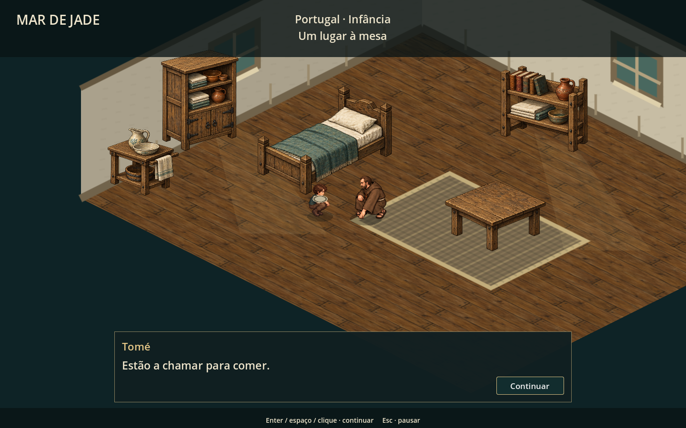
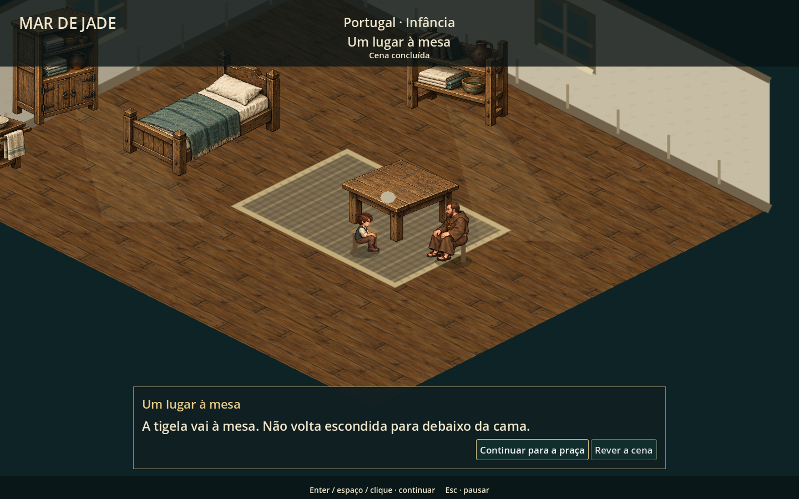
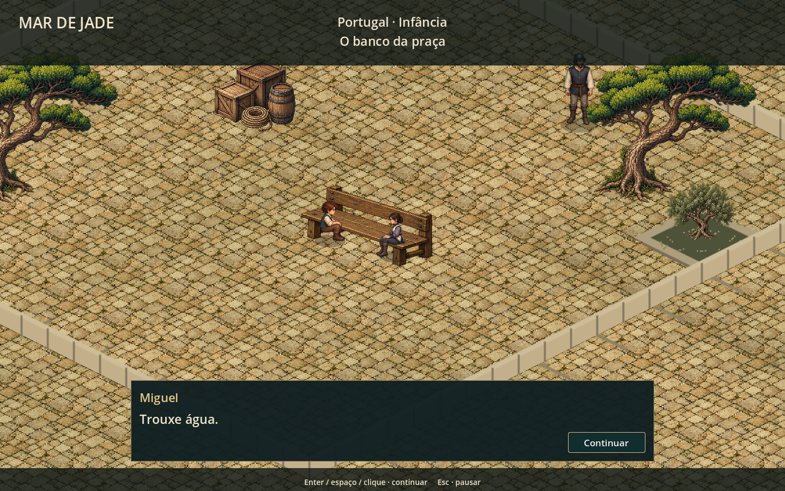
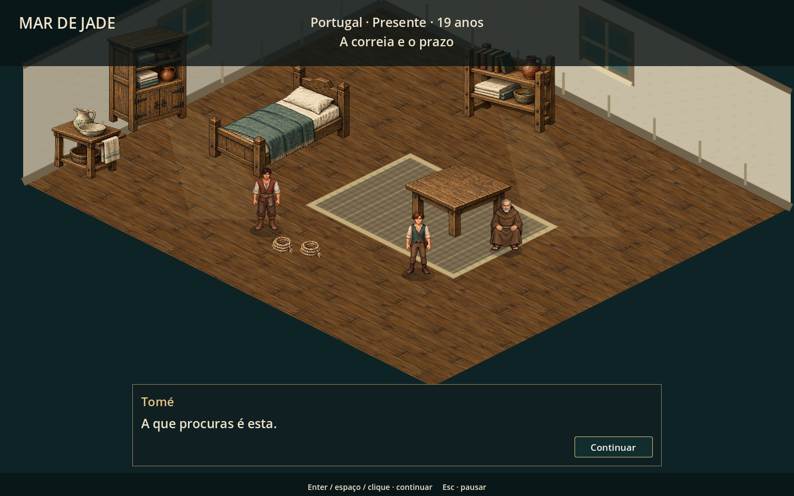
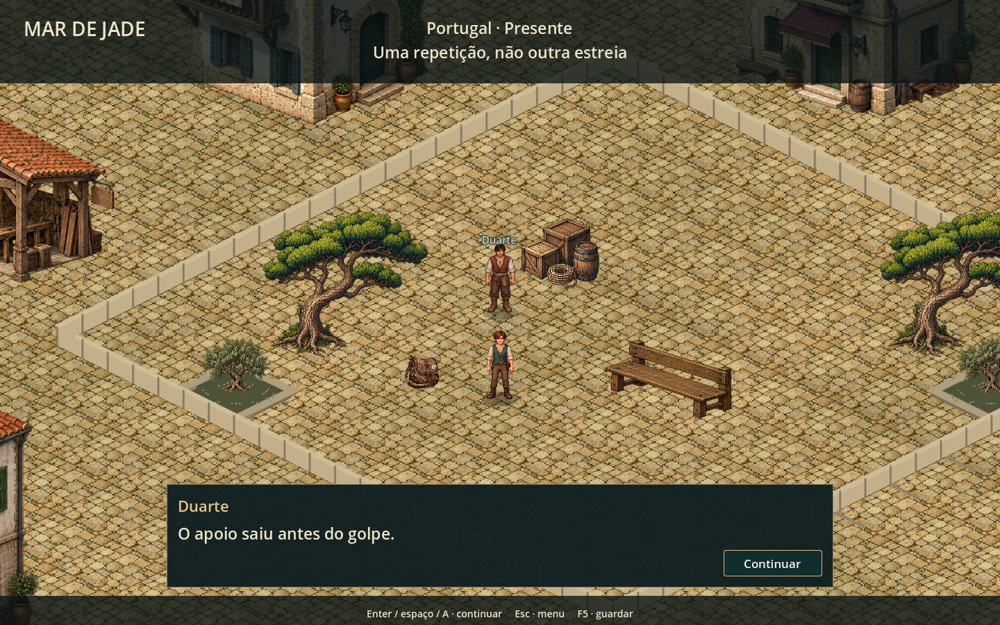
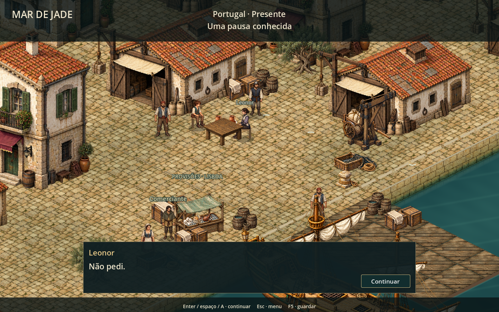

# Abrigo e praça — segunda passagem de acabamento

Continuação: [mesa, paredes, sombras e integração visual — antes/depois](mesa-paredes-integracao.md). As capturas abaixo acompanham a versão atual; o texto e os números desta página registram a segunda passagem.

16/10/2026. Esta passagem trabalha as proporções e a composição do abrigo e da praça, com efeitos partilhados no pátio, na refeição e na recuperação. Não representa o aceite visual final de toda a campanha.

## O que mudou

- Banco reduzido de 220 para 148 unidades de largura, com arte ilustrada e colisão correspondente. As duas posições de assento continuam dentro do banco.
- Cama e mesa receberam arte pintada na mesma paleta do elenco, com novas proporções e revisão dos polígonos de colisão.
- O abrigo ganhou armário de roupa, prateleira com livros/louça, lavatório, tapete tecido e luz de janela. O mobiliário adicional tem base física e deixa livre o percurso entre cama e mesa.
- Conversas da infância e abertura adulta usam enquadramento mais próximo. A praça devolve o controle à câmera de exploração nos exercícios de caminhada. A câmera respeita a pausa.
- Os personagens orientam-se entre si nas conversas do banco e na mesa do abrigo.
- A praça ganhou variação de desgaste no pavimento, canteiros com folhagem ilustrada e uma delimitação de pedra que indica a área caminhável.
- O diálogo curto ocupa cerca de 150 unidades de altura, em vez do painel anterior de 200–240. Texto comprido cresce conforme o conteúdo; escolhas e seleção de manejos conservam seus espaços maiores. O botão de continuação é compacto e segue as cores da campanha.

## Capturas reais

### Abertura no abrigo

### À mesa

### Banco da praça

### Retorno ao presente

### Pátio

### Refeição no cais

## Verificação

245 verificações sem falhas: abertura (23), praça com física e colisão reais (40), promessa (25), abertura adulta (19), percurso completo até ao embarque (41), transições/checkpoints (15), encerramento de combate (27) e inventário (55).

As capturas foram feitas no Godot/OpenGL. O percurso completo caminha até aos alvos e envia E pelo viewport; não teleporta o personagem para concluir as tarefas. Os testes desativam o autosave do jogador. O roteiro e o formato dos saves foram preservados.

Os testes headless ainda emitem o aviso de certificados Windows do ambiente. A revisão não inclui playtest humano prolongado nem novo acabamento artístico da navegação.

## Arte e reprodução

O mobiliário foi criado pela geração integrada de imagens com o jogo como referência. Fonte: [furniture-v1.png](../assets/art/portugal-v2/furniture-v1.png). O atlas contém cama, mesa, banco, armário, prateleira e lavatório, com transparência. [Prompt completo](furniture-generation.json).

`tools/build_furniture_assets.py` descreve os seis recortes sem modificar os pixels da fonte. `scripts/chapter/furniture_art.gd` partilha os recursos entre cenas. `tools/capture_campaign_maps.gd` reproduz as capturas do capítulo, incluindo a mesa e o banco após a encenação.
