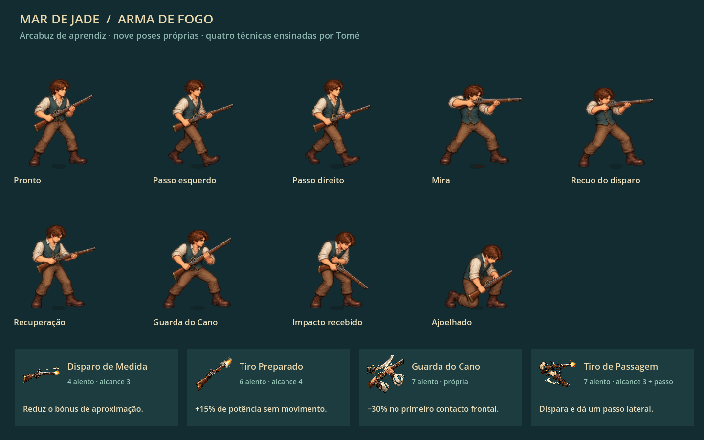

# Arma de fogo — arte e técnicas

Entrega de 19/10/2026. Tomé ensina as quatro técnicas ao confirmar a arma de fogo, conforme a escolha do jogador. A aula concluída pelo combate também concede o conjunto. O aprendizado aparece no menu e acompanha a preparação das abordagens.

## Arte

O herói adulto tem um atlas próprio com nove poses: pronto, dois passos, mira, recuo do disparo, recuperação, guarda, impacto recebido e ajoelhado. O arcabuz está ilustrado nas mãos do personagem; não usa o desenho de linhas da versão anterior. As demais armas continuam com suas artes anteriores.

Fonte transparente preservada em `assets/art/combat/portugal/hero-firearm-v1.png`. Gerada pelo imagegen integrado a partir do herói e do arcabuz existentes. O prompt completo e as referências estão em [firearm-generation.json](../assets/art/combat/portugal/firearm-generation.json). [build_firearm_frames.py](../tools/build_firearm_frames.py) mede os recortes, apoios e bocas do cano sem regravar os pixels da fonte.

O som e o clarão saem na liberação do disparo, antes do impacto. O clarão acompanha a boca ilustrada do cano; fumaça e recuo respeitam a opção de efeitos reduzidos. Os quatro ícones ilustrados anteriores foram reutilizados, cada um associado à técnica correta.

## Técnicas

As fichas seguem `habilidades-passivas-v2/armas-de-fogo.md` do corpus vigente. O básico recupera alento; manejo e recarga fazem parte da ação, sem novo contador de munição.

| Técnica | Alento | Alcance | Efeito |
|---|---:|---|---|
| Disparo de Medida · FO07 | 4 | Primeiro alvo em linha, até 3 | Bom/Perfeito reduz pela metade o próximo bônus comum de aproximação do alvo. |
| Tiro Preparado · FO01 | 6 | Linha livre, até 4 | Mira e dispara na mesma ação; +15% de potência se não houve movimento no turno. Mover continua permitindo disparar, sem esse bônus. |
| Guarda do Cano · FO08 | 7 | Própria | Reduz 30% do primeiro contato frontal até ao próximo turno próprio. Não protege de projéteis, flancos ou costas, nem concede tiro extra. |
| Tiro de Passagem · FO09 | 7 | Linha livre, até 3 | Dispara da posição inicial e só depois dá um passo lateral. O destino é mostrado na previsão; sem casa lateral livre, a técnica fica indisponível. |

Potências básicas deste recorte: 20 no básico, 17 em FO07/FO09 e 21 em FO01 antes do bônus imóvel e do equipamento. Os custos acima são anteriores ao desconto da passiva Treino Paciente, que considera a primeira técnica de arma usada na batalha. Mira de Aprendiz conserva seu efeito específico em FO07.

O passo lateral não permite adquirir linha de tiro através de uma parede. Mover e voltar à posição original não recupera o bônus imóvel; desfazer o movimento planejado recupera a elegibilidade. A Guarda do Cano usa seu estado próprio, sem herdar a redução de 50% da guarda genérica.

Ao carregar saves antigos que já contêm FO07, a aula de arma de fogo é completada com as outras três técnicas, sem mudar inventário, recursos ou recompensas. Quem ainda não aprendeu este manejo continua dependendo de Tomé. A migração de viagem só acontece após a validação do checkpoint e conserva coerentes o capítulo e a preparação a bordo.

## Experimentar

Na campanha, escolher **Arma de fogo** com Tomé. Na prática livre, há básico e as quatro técnicas. No teclado, **1–5** escolhem essas ações, **F** consulta os detalhes e **Espaço** confirma o timing. No controle, **X** seleciona o básico e **Y** percorre as técnicas.

Para uma revisão independente, abrir [firearm_study.tscn](../scenes/art/firearm_study.tscn) no Godot e usar F6. Não grava progresso. F1 permite trocar encontro, manejo e mapa.

[Previsão do passo lateral](arma-de-fogo-previsao-3.png) · [Previsão da proteção frontal](arma-de-fogo-previsao-8.png) · [Disparo no jogo](arma-de-fogo-acao-2.png).

## Validação

610 verificações aprovadas: firearm (119), weapon_choice (43), practice_freedom (127), combat_field (23), combat_economy (65), combat_presentation (19), combat_feel (36), boarding (78), navigation_campaign_entry (12) e navigation (88). Cobrem regras, custo e passivas, alvo e dano previsto, contato frontal, passo posterior ao tiro, controle, aprendizado, continuidade e migração de saves. Onze imagens nativas do Godot foram geradas e a galeria e as previsões foram inspecionadas.

A suíte geral integration_closure não concluiu o retorno a Lisboa porque tenta gravar o checkpoint em `user://`, fora da área gravável desta sessão: o diagnóstico retornou erro 12 na pasta padrão e sucesso ao gravar o mesmo estado em `.qa-runtime`. Essa suíte não está incluída nas 610 aprovações. Não foi alterada a permissão nem o caminho de saves do jogador. Os registros também conservam o aviso do ambiente sobre certificados e o aviso anterior de objetos retidos em combat_economy. A verificação de controle foi automatizada; equilíbrio e sensação ainda podem ser refinados com uma partida humana.

## Sons por técnica — 20/10/2026

O básico, Disparo de Medida, Tiro Preparado e Tiro de Passagem têm quatro efeitos distintos, derivados de gravações CC0 do Freesound, o mesmo banco usado no projeto atual de Mar de Ferro. Fontes: [Musket Shot.wav — mlsulli](https://freesound.org/people/mlsulli/sounds/234869/), [musket.wav — fennelliott](https://freesound.org/people/fennelliott/sounds/347647/) e [Musket Explosion — Willlewis](https://freesound.org/people/Willlewis/sounds/244345/).

O básico tem estampido e cauda natural; Disparo de Medida usa outra gravação, mais curta; Tiro Preparado tem corpo mais grave e cauda maior; Tiro de Passagem é mais breve e agudo. São diferenças de timbre, sem alterar dano, ações ou timing. Guarda do Cano conserva apenas o manejo de proteção, sem tiro. O início do manejo usa o efeito existente de preparação em vez de confirmação de menu.

A escolha usa a técnica efetivamente executada, inclusive na abordagem, na liberação sincronizada com a boca do cano. O impacto no alvo continua separado. O som antigo de treino permanece disponível para o uso naval existente. Os efeitos respeitam o volume de efeitos e a pausa do jogo.

Originais, URLs, licença e transformações estão em `assets/audio/combat/sources/` e `firearm-credits.json`. `tools/build_firearm_audio.py` reproduz a conversão mono 44,1 kHz, corte do silêncio inicial, normalização e fade. Não há geração por IA. Comparação: [básico → Medida → Preparado → Passagem](firearm-audio-comparison.wav).

Validação: 124 verificações de arma de fogo e 36 de resposta de combate aprovadas. Os quatro arquivos carregam no Godot e a guarda não seleciona estampido. A escolha final de timbre e volume fica disponível para audição do jogador.

## Animações por técnica — 20/10/2026

As poses ilustradas existentes agora compõem cinco sequências: básico com preparação direta; Disparo de Medida com elevação gradual e recuo curto; Tiro Preparado com coronha firmada, corpo assentado e recuo mais forte; Tiro de Passagem com ombro rápido e recuperação compacta antes do deslocamento real; Guarda do Cano com elevação para a posição transversal, sem pose de disparo.

Cada sequência tem seus próprios tempos de poses, inclinação e recuo. A liberação do projétil, o som, o impacto e as regras permanecem sincronizados no tempo original. O passo lateral conserva origem e destino reais; efeitos reduzidos diminuem recuo e inclinação, preservando as poses que distinguem as técnicas. As mesmas sequências são usadas em terra e nas abordagens. Os pivôs dos pés e a boca do cano continuam calculados a partir do quadro ilustrado.

[Comparação animada das cinco sequências](arma-de-fogo-animacoes.gif), reproduzível por `tools/capture_firearm_animations.gd`. Trata-se de composição e movimento das poses existentes; não foram geradas novas ilustrações. Validação: **249 verificações aprovadas** nas suítes de arma de fogo, resposta de combate e abordagem, incluindo sequências distintas, liberação sincronizada e redução de recuo.

## Silhuetas próprias — revisão após comparação do jogador

A revisão anterior alterava principalmente duração e recuo das mesmas poses e ficou visualmente semelhante. Esta versão substitui a arte das quatro técnicas por **12 quadros novos**, em quatro sequências próprias:

- **Disparo de Medida:** postura ereta e estreita, mira elevada, baixa o cano ao recuperar.
- **Tiro Preparado:** apoia um joelho no chão para mirar e disparar, depois começa a levantar.
- **Tiro de Passagem:** base baixa e muito aberta, disparo em avanço lateral e recuperação cruzando as pernas; mantém o deslocamento real já previsto.
- **Guarda do Cano:** arma quase vertical atravessada diante do corpo, bloqueio e desvio para fora; a guarda persistente também usa essa arte.

O básico conserva a ilustração anterior. As novas silhuetas permanecem distintas com efeitos reduzidos; não dependem de fumaça, cores ou intensidade do recuo para serem reconhecidas. A geração integrada usou o atlas anterior como referência de personagem. Fonte e prompt estão em `assets/art/combat/portugal/firearm-techniques-generation.json`; imagem em `hero-firearm-techniques-v2.png`. O medidor `tools/build_firearm_technique_frames.py` só lê os pixels para gerar retângulos, pivôs e bocas do cano, sem reescrever a imagem.

O renderizador usa a mesma escala anatômica para manter o ajoelhado realmente mais baixo. Os quadros de contato de cada técnica pertencem a linhas diferentes do atlas; o passo lateral conserva sua recuperação própria em vez de voltar à caminhada genérica. Liberação, som, impacto, alvos e dano continuam nos tempos e regras anteriores.

[Comparação animada revisada](arma-de-fogo-animacoes-v2.gif). **257 verificações aprovadas**: 143 de arma de fogo, 36 de resposta de combate e 78 de abordagem. Incluem seleção dos quadros novos e silhuetas baixa/aberta; a comparação nativa também foi inspecionada em contato e recuperação. A preferência visual continua sujeita à avaliação do jogador.
