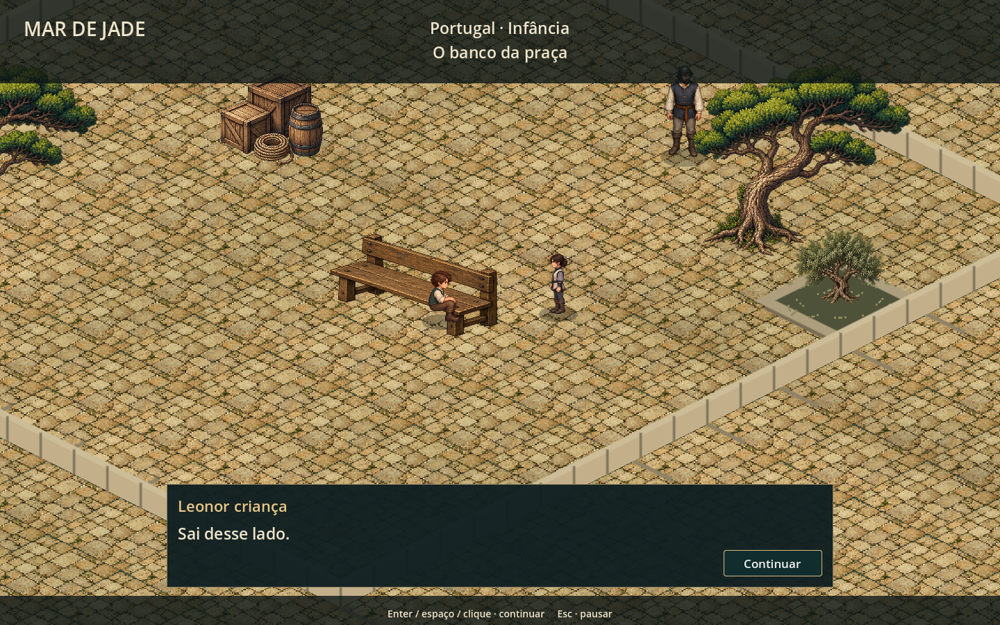
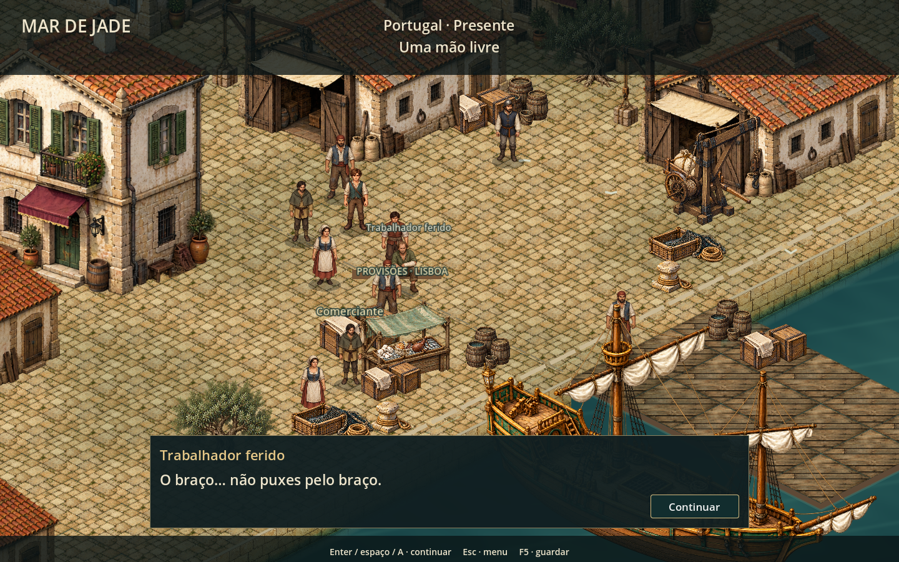
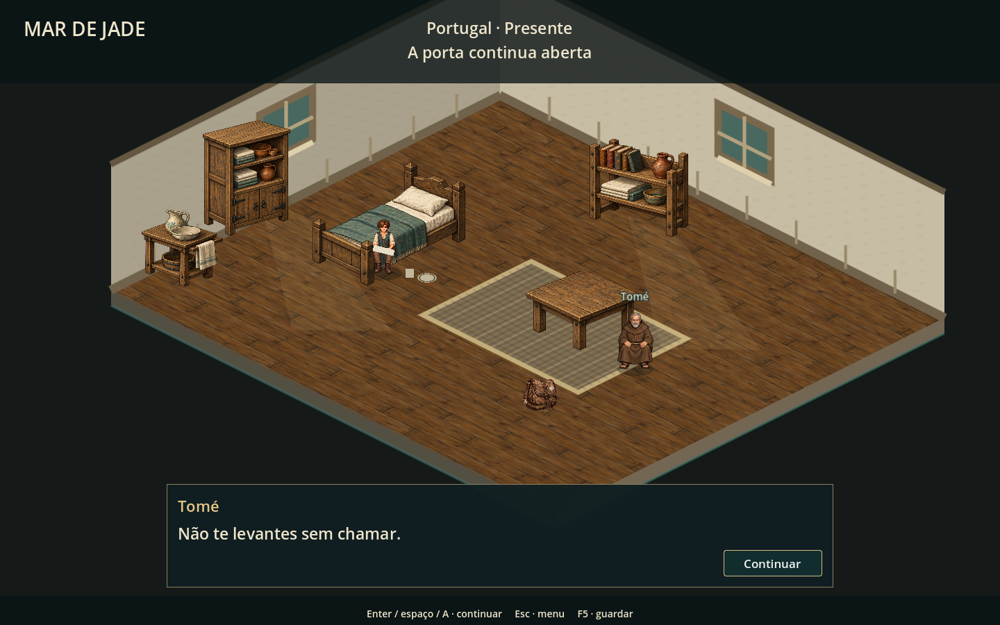
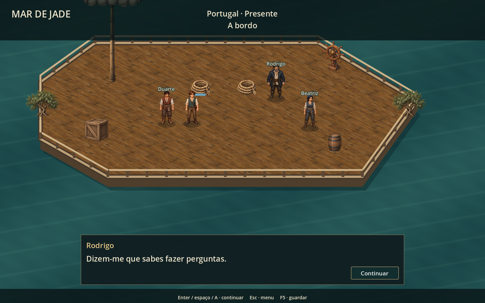

# Revisão dos mapas de Portugal até ao embarque

Revisão de 16/10/2026. Abrange o abrigo infantil, praça, treino, promessa, abertura adulta, pátio, socorro no cais, refeição, recuperação e convés de partida.

Atualização posterior: [segunda passagem de proporções e composição do abrigo e da praça](abrigo-praca-acabamento.md). As capturas abaixo mostram a versão atual; o registro desta página descreve a primeira passagem.

## Correções

- Herói infantil com atlas próprio de 20 quadros: quatro direções de caminhada e poses de sentado/agachado. Substitui o boneco procedural e o adulto reduzido.
- Herói adulto à escala de 84 unidades, coerente com o elenco. Quatro poses narrativas próprias conservam o rosto e a roupa ao sentar/agachar.
- Praça e pátio com pavimento contínuo, edifícios de Lisboa e canteiros. A água e as faces de plataforma desaparecem dos limites destas cenas; o mar fica reservado ao cais e ao navio.
- Abrigo infantil, abertura adulta e recuperação partilham piso de tábuas, paredes com janelas e mobiliário tratado com os mesmos materiais.
- Câmara de diálogo do abrigo enquadra os dois interlocutores acima do painel; herói recupera sentado junto à cama. Assentos acompanham as poses à mesa.
- Banco com assento estreito, tábuas e encosto. A pose infantil deixa de ser deslocada 45 unidades para cima.
- Refeição com mesa, louça e pose sentada após entregar as porções. Sacola, cordas e louça usam a arte do inventário.
- Embarque com casco, convés texturado, amuradas, mastro, leme, carga e amarra azul. O contorno do casco determina também o limite de caminhada.
- Interação de tarefa interceptada pelo diretor antes do viewport do combate encerrado. E/A volta a executar os objetivos após o treino; a proteção de entrada durante a cortina do combate foi conservada.
- O teste completo agora percorre os caminhos com física real e envia E pelo viewport. Não teleporta o personagem para concluir as tarefas.

## Capturas do jogo

Estas imagens são capturas do Godot/OpenGL, não montagens.

### Praça infantil

### Abrigo

### Pátio adulto

### Cais

### Refeição

### Recuperação

### Embarque

Outras capturas: [treino](../previews/campaign-training.png), [promessa](../previews/campaign-promise.png), [presente](../previews/campaign-adult_opening.png), [demonstração](../previews/campaign-block-06.png), [regresso ao pátio](../previews/campaign-block-13.png) e [Defesa Perfeita](../previews/campaign-block-14.png).

## Validação

257 verificações sem falhas: abertura (20), praça com deslocamento e colisão reais (38), elenco (27), transições e checkpoints (15), percurso completo dos 17 blocos até à partida (41), visita ao comerciante/embarque (34), encerramento do combate (27) e inventário (55).

Captura reproduzível: `tools/capture_campaign_maps.gd`. Metadados das novas poses: `tools/build_hero_child_assets.py`. O roteiro e o formato dos saves não foram alterados. Os ensaios desativam o autosave do jogador.

O ambiente de execução emite aviso de certificados Windows. A ferramenta de captura também emite um aviso de instâncias ao encerrar; não houve erros de script na captura final. Não foi feito um playtest humano prolongado.

## Arte nova

Geração integrada de imagens, com os atlas existentes como referência. Prompts completos e destinos em [campaign-map-hero-prompts.json](campaign-map-hero-prompts.json).

- `assets/art/npcs/lisbon/hero_child-v1.png`: protagonista criança, 20 quadros, transparência real.
- `assets/art/portugal-v2/hero-story-poses-v1.png`: protagonista adulto sentado/agachado, quatro quadros, transparência real.

Os PNGs anteriores foram preservados. Arquitetura, móveis, materiais e objetos restantes reutilizam os recursos existentes do projeto.
