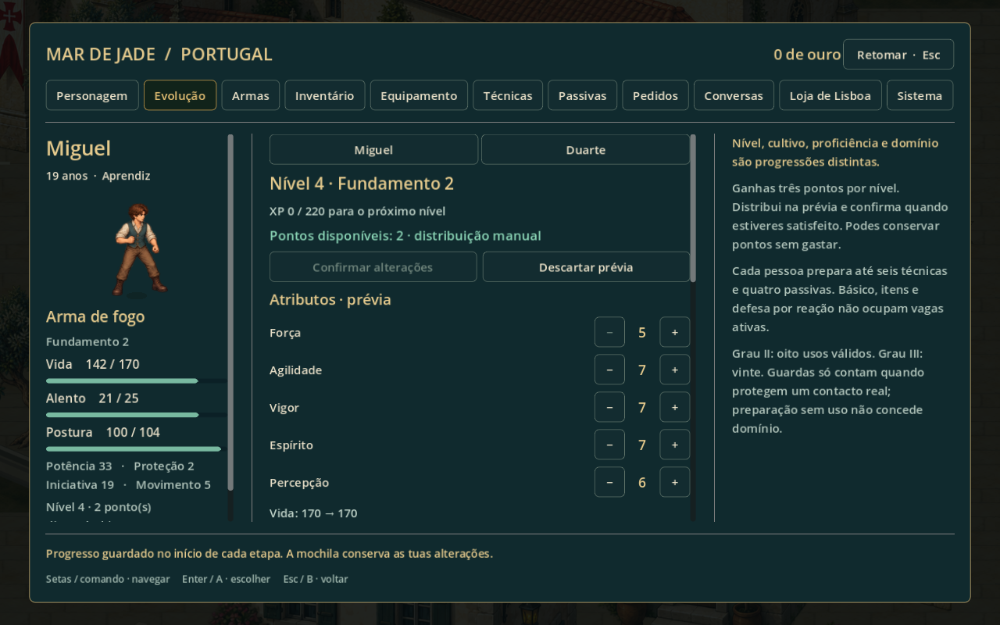
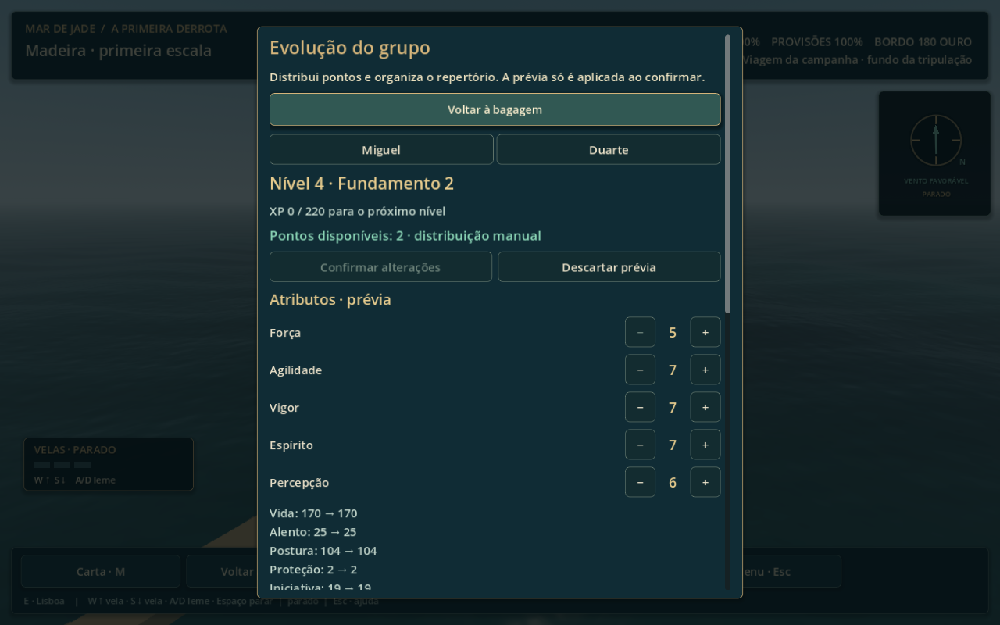

# Desenvolvimento do personagem — Portugal e abordagens

Implementação do recorte confirmado na [entrevista](entrevista-desenvolvimento-personagem.md). Abrange protagonista adulto e Duarte, com ficha compartilhada em terra e a bordo. Infância, ferimentos narrativos e acontecimentos da história conservam suas regras próprias.

## Usar a ficha

Em **Pausa → Personagem e bagagem → Evolução**, escolhe o personagem, distribui os pontos e compara a prévia. **Confirmar alterações** aplica a distribuição e o repertório; **Descartar prévia** abandona as mudanças. A bordo, Evolução abre diretamente o mesmo editor. Redistribuir é gratuito em segurança. Em combate ou durante situações bloqueadas, a consulta permanece disponível sem alterações.

A ficha mostra recursos atuais/máximos, origem dos limites, proteção, iniciativa, movimento e potência básica com equipamento. A potência, o custo, o alcance e as influências próprias de cada técnica ficam em Conhecimento e na previsão de combate. Reduzir um máximo limita o recurso atual; aumentar atributos ou trocar equipamento não cura.

## Nível e atributos

Adulto começa no nível 1; teto 60. FOR, AGI, VIG, ESP e PER começam em 5, com teto 60 e três pontos manuais por nível. Aliados recrutados recebem a mesma quantidade de XP das recompensas seguintes. Duarte entra no nível 3, com seis pontos disponíveis, sem XP anterior ao recrutamento.

Fórmulas provisórias usadas neste recorte, antes do equipamento:

| Valor | Fórmula |
| --- | --- |
| XP para o próximo nível L | 100 + 25(L−1) + 5(L−1)² |
| Vida máxima | 100 + 10(L−1) + 14(VIG−5) |
| Alento máximo | 20 + piso((L−1)/3) + 2(ESP−5) |
| Potência P(X,Y) | 18 + 0,90X + 0,35Y + 2(L−1) |
| Postura máxima | 100 + 2(VIG−5) |
| Proteção dos atributos | piso((VIG−5)/5) |
| Iniciativa | base 18, ou 24 para Duarte, + piso((AGI−5)/2) |

Postura, proteção e iniciativa são adaptações provisórias para o combate atual. Movimento básico permanece cinco casas; Agilidade não concede deslocamento adicional nem timing automático. Força acrescenta pressão de postura aos ataques do protagonista. Equipamento acrescenta suas contribuições depois dos atributos; o arredondamento ofensivo ocorre no resultado final.

Básicos: espada FOR/PER, lança FOR/AGI, machado FOR/VIG, fogo PER/AGI, desarmado AGI/FOR. As técnicas existentes usam os pares e coeficientes próprios dos documentos:

| Técnica | Potência antes do equipamento/domínio |
| --- | --- |
| ES07 Ponta Breve | 0,80 P(PER,AGI) |
| LA07 Ponta de Medida | 0,90 P(PER,FOR) |
| PU07 Punho de Medida | 0,85 P(AGI,PER) |
| FO07 Disparo de Medida | 0,85 P(PER,AGI) |
| FO01 Tiro Preparado | 1,05 P(PER,AGI), +15% sem movimento |
| FO09 Tiro de Passagem | 0,85 P(AGI,PER) |

MC08 e FO08 são guardas sem dano. DU01 prepara uma interceptação, sem potência ofensiva. Exercícios temporários C01-DEMO continuam identificados como conteúdo de prática, não como técnicas aprendidas da campanha.

No Normal, subir nível restaura vida e alento do personagem vivo, incluindo máximos de equipamento; no Desafiante, preserva os recursos gastos. A restauração não remove ferimento narrativo nem revive personagem abatido. Após vitória numa abordagem, o retorno mínimo do abatido é um ponto de vida, sem alento gratuito, salvo recuperação explícita por nível no Normal.

## Recompensas finitas

| Marco principal | XP |
| --- | ---: |
| C01-M01/S08 | 40 |
| C01-M02/S03 | 60 |
| C01-M03/S01 | 80 |
| C01-M03/S07 | 80 |
| C01-M04/S02 | 60 |
| C01-M04/S04 | 80 |
| Total principal | 400 |

400 XP levam ao nível 4 e concedem nove pontos, sem opcionais. Pedidos concluídos concedem 25 XP cada; observações da maré, corda e manifesto, 10 cada; vitória em abordagem, 35 por encontro identificado. Um registro persistente impede recompensas repetidas. Exercícios livres não geram XP ou domínio infinitos.

## Repertório, domínio e cultivo

Cada pessoa tem seis vagas ativas e quatro passivas próprias. Aprender uma técnica preenche uma vaga ativa livre; retirar do repertório ou trocar arma preserva o aprendizado. O combate exige técnica aprendida, preparada e compatível com o manejo. Básico, movimento, itens e Defesa Perfeita ficam fora das seis vagas. Não existe comando Defender.

Domínio I/II/III depende de execuções válidas: grau II em oito usos; III em vinte. Vitória contabiliza até seis usos por técnica no encontro. Ataques precisam causar dano; guardas e apoio precisam efetivamente interceptar contato. Graus ofensivos acrescentam 5%/10%; guardas passam de 30% para 33%/35%; Guarda Companheira reduz custo em um/dois, respeitando desconto total máximo de dois. Domínio não acrescenta ação ou alcance.

Proficiência é separada, de zero a mil por manejo: primeira aula dá 40 uma única vez; uso válido numa vitória dá quatro por execução, até 24 por encontro. As cinco trilhas persistem ao trocar arma. O cultivo registra cinco patamares com três subníveis; a primeira aprendizagem atual comprova Fundamento II. Patamares seguintes dependem de conteúdo e provas narrativas futuras, não são comprados com XP.

## Itens, estados e continuidade

Arma, traje, calçado e acessório continuam com comparação e limites derivados. Preparação de equipamento, passivas e técnicas respeita segurança. Consumíveis sem efeito não são gastos, não revivem abatidos e não tratam ferimentos narrativos. Vida/alento gastos acompanham a viagem; condições temporárias comuns ficam na batalha. A apresentação distingue dano de vida e postura e identifica os estados executáveis atuais.

Esta entrega integra os efeitos das técnicas existentes. Não implementa antecipadamente as centenas de técnicas do catálogo nem todos os estados e regras de controle previstos para capítulos futuros. A meta de nível próximo de 50 no final principal depende da campanha posterior e não foi simulada neste recorte.

Saves passam ao esquema 13. Versões anteriores recebem a estrutura de desenvolvimento sem alterar inventário, escolhas ou recursos atuais. Marcos principais já concluídos reconstituem XP do protagonista; Duarte conserva o nível de entrada sem receber XP histórica. A aula antiga de arma de fogo prepara as quatro técnicas conhecidas. Dados inválidos são recusados antes de alterar o estado em memória.

## Verificação

O executor `tools/test_character_development.ps1` roda 15 suítes em diretórios de usuário exclusivos de QA, sem usar os saves pessoais. Cobre progressão, orçamento, prévia/confirmar, bloqueios, recursos, migração, repertório, técnicas, economia, continuidade e o percurso completo de 17 cenas. Resultado final: **816 verificações aprovadas, sem falhas, em 15 suítes** (57 na suíte de desenvolvimento após os dois testes adicionais de descobertas; demais suítes aprovadas no executor completo). O percurso completo atravessou as 17 cenas e confirmou 400 XP, nível 4 e nove pontos disponíveis sem opcionais.

Capturas reproduzíveis por `tools/capture_character_development.gd`: ficha, prévia, repertório, janela 960×600 com fonte ampliada e ficha a bordo. O roteiro usa um estado de demonstração isolado. Capturas verificam apresentação; balanceamento subjetivo e conforto numa partida natural ainda dependem de playtest humano.

