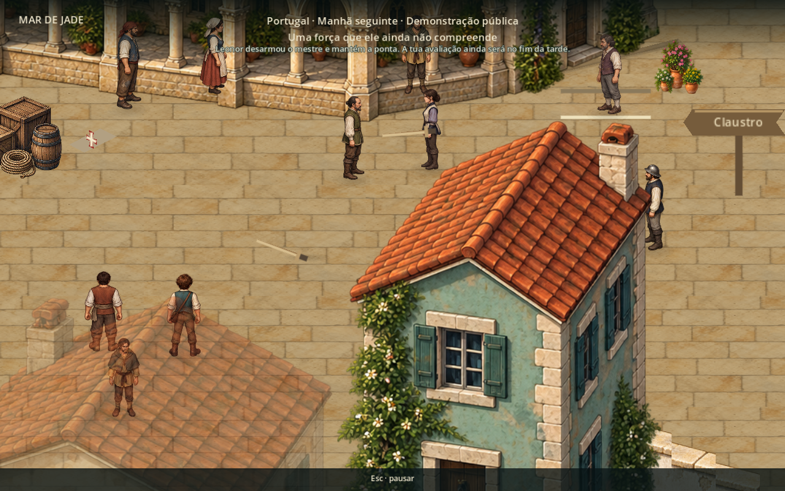
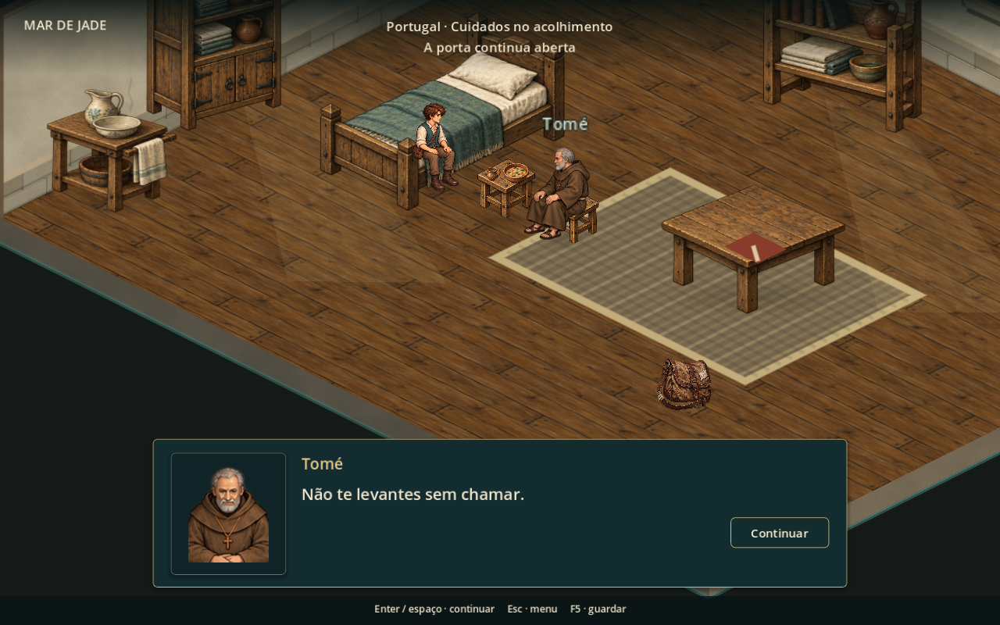
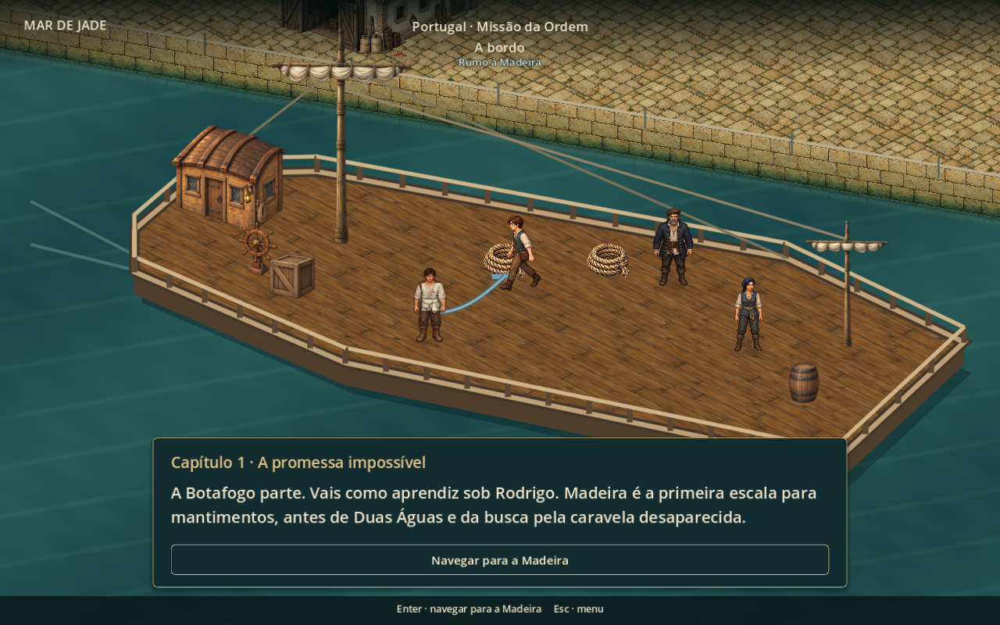

# Arco 1 — demonstração, recuperação e partida

Entrega de 16/10/2026, continuando a [lista de direção](reviews/revisao-direcao-arco-01.md) e o [primeiro pedido de Lisboa](cais-pedidos.md).

## O que mudou

**Demonstração pública (pontos 5 e 13):** o mestre recebe um ataque, apara, responde e desarma o combatente. Leonor entra depois; o mestre faz uma primeira tentativa, recompõe-se e tenta novamente. Leonor desarma-o e mantém a ponta. Os instrumentos caem e permanecem no chão. Seis espectadores assistem à demonstração; a avaliação reservada seguinte não herda essa plateia. Herói e Duarte olham para a luta. A carga da praça foi reposicionada para não ocultar o mestre.

**Recuperação (pontos 9 e 11):** Tomé senta-se junto ao protagonista, com enquadramento mais próximo. Na fala que pede água, E/A faz o protagonista beber ainda sentado: a caneca sai do apoio, é levantada e volta ao lugar. A ação não cura a lesão. Depois da passagem narrativa de tempo, ele sai da cama para uma posição caminhável, alcança o primeiro apoio e volta até Tomé antes de retomar os treinos. Não foi inventada uma duração para a recuperação.

**Gestos e responsabilidade (avanço dos pontos 2 e 14):** o pano passa a ser apresentado ao alcance do protagonista na refeição. No convés, a amarra azul precisa ser recolhida e levada até Duarte. Inspecionar a branca provoca uma correção de Beatriz. A corda acompanha visualmente o protagonista até a entrega.

**Embarque (ponto 10 e avanço do 12):** a Botafogo usa uma cena própria, sem instanciar a praça. Casco, chão navegável e obstáculos pertencem ao navio; árvores, muros e efeitos de piso da cidade não são herdados. Há mastros, cordame, leme, casario e carga. Na partida, navio e tripulantes afastam-se, enquanto cais e câmera permanecem fixos; rastro e efeitos sonoros acompanham a saída. O botão final continua a abrir a viagem Lisboa → Madeira.

Esc/Start pausa as sequências, inclusive movimentos e esperas. Retomar continua a mesma ação; carregar/recomeçar ficam indisponíveis durante sua execução, com indicação no menu. As 250 falas aprovadas dos 17 blocos adultos foram preservadas.

## Validação executada

| Ensaio | Verificações | Resultado |
|---|---:|---|
| Encenação com renderização OpenGL | 48 | Sem falhas |
| Percurso dos 17 blocos e sete tipos de combate | 51 | Sem falhas |
| Encerramento dos combates | 27 | Sem falhas |
| Abrigo e transição à praça | 41 | Sem falhas |
| Interface do primeiro teste | 39 | Sem falhas |
| Inventário e menu | 56 | Sem falhas |
| Rotas do capítulo | 15 | Sem falhas |
| Entrada da campanha na navegação | 12 | Sem falhas |

O teste de encenação usa entrada E, caminhada e colisões reais, verifica a pausa, os dois desarmes, as duas etapas de recuperação, a escolha da corda, a entrega a Duarte e o afastamento do navio. Também compara os arquivos de save antes/depois para garantir que a execução não alterou o progresso do jogador. As capturas desta página foram inspecionadas a 1280 × 800.

O validador de conteúdo confirmou **17 blocos, 250 falas aprovadas e nenhuma divergência**. Os avisos de certificados e gravação do cache OpenGL pertencem ao ambiente de execução e não impediram a conclusão dos ensaios.

## Limites e próximas pendências desta entrega histórica

**Atualização de 17/10:** socorro, conteúdo local, pátio, economia, interface, acessibilidade e navegação receberam a passagem seguinte. Consultar o [fechamento dos 43 pontos](reviews/arco-01-fechamento-da-revisao.md) para o estado atual. Os olhos foram retirados deste fechamento por orientação do usuário. Os parágrafos seguintes conservam as pendências registradas na data desta entrega.

Esta entrega cobre esses trechos da lista, não a revisão inteira. As lutas usam as poses ilustradas existentes, com deslocamentos, orientação, armas e contatos animados; ainda não há uma nova série de quadros desenhados para cada golpe. A equivalência visual completa entre esta Botafogo e sua versão de navegação também permanece para revisão.

Continuam pendentes a expansão de conteúdo local, a reconstrução do socorro, os olhos canônicos do protagonista, outros enquadramentos íntimos, a saída livre dos treinos com troca de armas e repertório maior, além das demais melhorias de economia, interface, acessibilidade e navegação. Os testes automatizados não medem compreensão, emoção ou ritmo percebido; isso exige playtest humano.

## Arquivos principais

- Encenação: `scripts/chapter/chapter_staging.gd`, `staged_instrument.gd` e `staged_contact.gd`.
- Fluxo e interações: `scripts/chapter/chapter_flow.gd` e `data/chapter_01/chapter_flow.json`.
- Navio e margem: `scenes/maps/botafogo_departure.tscn`, `scripts/chapter/departure_deck.gd` e `departure_shore.gd`.
- Ensaio reproduzível: `tests/chapter_staging.gd`.

Executar o ensaio com Godot 4.5.1, `--path` apontando para o repositório principal, `--rendering-method gl_compatibility --script res://tests/chapter_staging.gd` e `--log-file` em uma pasta gravável. O teste gera as capturas em `previews/staging-*.png`.
