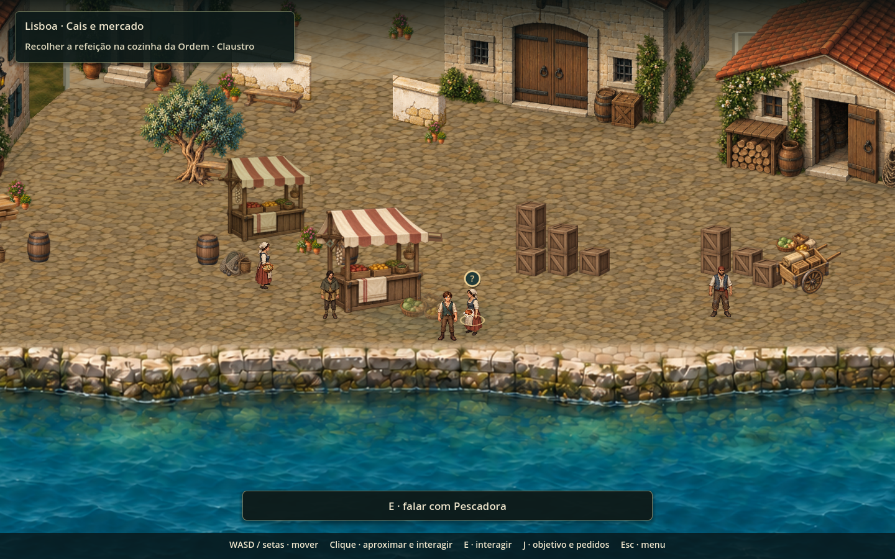
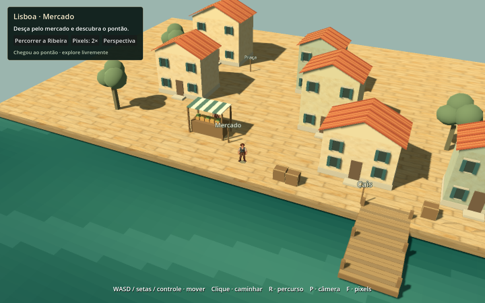
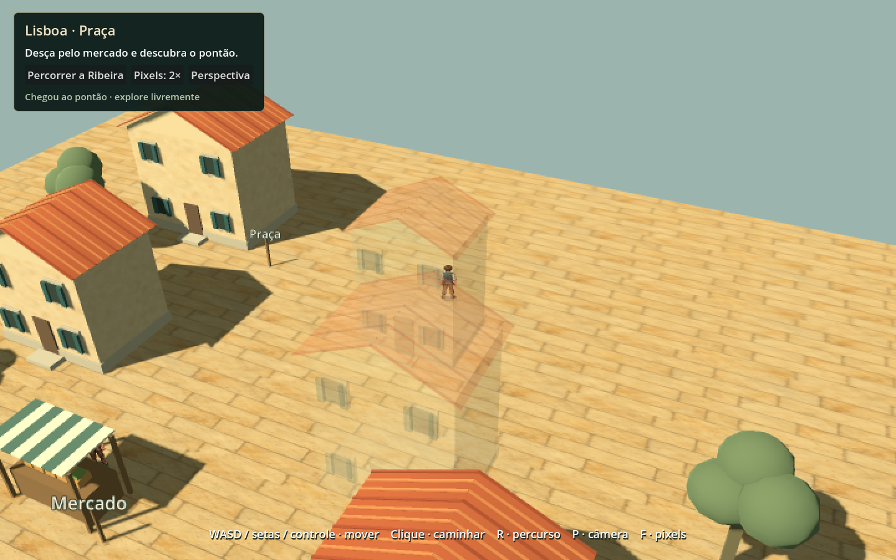

# Lisboa: amostra jogável de cenário 3D e personagens em sprites

22/10/2026. Primeiro experimento de apresentação derivado da observação de Wandering Sword e da direção proposta para Jade. Os inventários e relatórios da instalação usada como referência ficam na pesquisa local; não são necessários para executar ou reproduzir este estudo.

## O que foi entregue

Uma cena jogável independente: `scenes/art/lisbon_hd2d_study.tscn`. Ela testa cenário tridimensional, sprites originais de Jade, câmera em perspectiva e luz com sombras reais. As casas, árvores, banca, carga e pontão usam geometria provisória criada em GDScript. A geometria não reconstrói integralmente os edifícios da campanha nem pretende representar o acabamento final de Wandering Sword.

Os dez pontos do percurso praça → mercado → cais vêm de `scripts/city/lisbon_blocks.gd`, convertidos do plano atual para coordenadas 3D com escala de 80 unidades por metro em X e 40 em profundidade. Esse mapeamento é uma hipótese do estudo, não uma conversão física definitiva do mapa. Os edifícios são uma composição nova em torno desse percurso.

O protagonista conserva o atlas, as poses e o recorte dos quadros já existentes. As superfícies reutilizam os materiais originais de calcário e cal de Jade. Mipmaps são gerados em memória para os materiais 3D, sem mudar os arquivos de importação compartilhados. A água usa um shader novo e simples.

Não foram incorporadas imagens, mapas, código ou músicas extraídos de Wandering Sword. O FOV inicial de 40° é um parâmetro de comparação observado na análise; a posição, a altura e o enquadramento foram escolhidos para a escala desta cena.

## Jogar e comparar

Na raiz oficial `C:/Users/gamer/Documents/GitHub/mar-de-jade`:

```powershell
./tools/play_hd2d_study.ps1
```

O script abre uma janela interativa do Godot e direciona os dados da execução para a pasta de QA. Também é possível abrir a cena no editor e executá-la com F6. Os atalhos oficiais `Jogar.cmd` e `Abrir-no-Godot.cmd` continuam sendo os acessos à campanha e ao projeto principal.

| Comando | Ação |
| --- | --- |
| WASD / setas | Caminhar conforme os eixos da câmera |
| Analógico esquerdo | Caminhar, se houver controle conectado |
| Clique no chão | Caminhar em linha direta até o ponto; as colisões continuam ativas |
| E / botão A | Conversar com o comerciante quando estiver próximo |
| R / Percorrer a Ribeira | Voltar ao começo e percorrer fisicamente os dez pontos |
| P / botão de câmera | Alternar perspectiva e projeção ortográfica |
| F / botão de pixels | Alternar amostragem de apresentação em 1× e 2× |
| Esc | Fechar a conversa |

O clique ainda não calcula desvios ao redor dos edifícios. Movimento manual cancela o percurso automático. Se o personagem sair da margem e cair, retorna ao último ponto seguro alcançado. A conversa local é uma orientação de exploração; não oferece loja, recompensas ou progresso da campanha.

O modo 2× amostra a imagem final da cena em blocos maiores. Ele permite comparar legibilidade e escala, mas não transforma automaticamente os desenhos existentes em uma nova família de pixel art. A interface permanece em resolução normal.

## Comparação visual

Capturas em 1440 × 900, feitas no Godot/OpenGL. O protagonista está no mesmo ponto lógico do percurso; cenário, projeção e enquadramento são distintos. A comparação mostra duas abordagens de apresentação, não um antes/depois com identidade visual e geometria já equivalentes.

| Campanha atual | Experimento híbrido com geometria provisória |
| --- | --- |
|  |  |

A campanha atual possui arte mais detalhada e uma cidade mais completa. O ganho demonstrado pelo estudo é técnico: volumes reais, sombras coerentes com esses volumes, comparação de projeções e possibilidade de compor sprites num mundo 3D. A qualidade artística ainda precisa de autoria específica e comparação humana em movimento.

Os edifícios que interceptam a visão da câmera até o corpo do protagonista ficam transparentes, incluindo o telhado. A colisão permanece ativa. Essa é uma solução experimental por edifício; o recorte localizado existente na campanha é outra abordagem a comparar.



## Verificação realizada

```powershell
./tools/play_hd2d_study.ps1 -Verify
./tools/play_hd2d_study.ps1 -Capture
./tools/play_hd2d_study.ps1 -Baseline
```

Foram aprovadas **25 verificações** em execução sem renderização e novamente com renderização OpenGL. Entre elas: inicialização, câmera, alternância 1×/2×, percurso pelos dez pontos até ao pontão, sustentação pelo piso, colisão com casa, conversa, cancelamento por tecla, transparência e restauro das construções, clique com chegada ao destino, retorno após queda e limites dos controles em 960 × 600.

As capturas foram inspecionadas na praça, no mercado, no cais e durante a oclusão. Uma revisão das primeiras imagens levou à redução da exposição, à geração de mipmaps em memória e ao fechamento das empenas dos telhados. O teste de percurso também identificou um pequeno degrau físico na margem; os pisos foram nivelados antes da verificação final.

O roteiro de referência carregou a campanha atual e produziu três capturas, com salvamento automático e persistência de preferências desativados. A cena inicial e as regras compartilhadas da campanha não foram modificadas por esta entrega.

Artefatos reproduzíveis em `.qa-runtime/hd2d/`: `verification.json`, logs por modo, `praca.png`, `praca-ortografica.png`, `mercado.png`, `cais.png`, `conversa.png`, `oclusao.png`, `compacto-960.png` e capturas `before-*`. O ambiente emitiu avisos de certificados do Windows e de gravação do cache gráfico; as verificações terminaram sem erros de script e as imagens foram produzidas. Controle físico, desempenho em hardware diferente e sensação de movimento ainda não foram avaliados por uma pessoa.

## Decisão que a amostra permite

Avaliar se o ganho de volume e perspectiva justifica produzir uma família de cenários 3D com sprites. A migração da cidade, das missões, do combate e dos interiores não foi executada. Esta entrega fornece o percurso jogável e os controles de comparação para fundamentar essa decisão.
