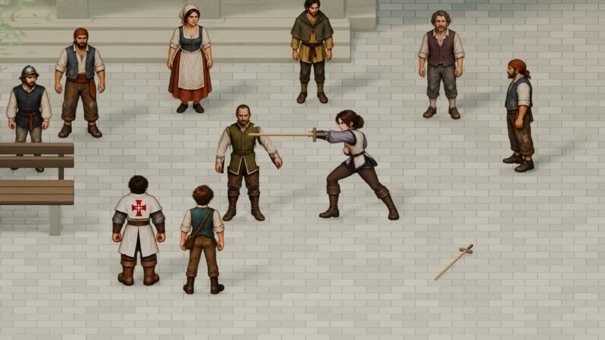

# Leonor e o mestre visitante — animação no Blender

23/10/2026. Cena de 16 segundos, em 1280 × 720 e 24 quadros por segundo, criada no Blender 5.2.2 LTS. O adversário chamado de Grande Guerreiro no pedido corresponde ao mestre visitante da demonstração pública; o roteiro mantém o nome dele em aberto.

## Assistir e editar

- Vídeo com música, sons de passos, contatos de madeira e legendas: [leonor-praca.mp4](../previews/leonor-praca.mp4).
- Fonte editável, com as imagens empacotadas: [leonor-praca.blend](../art-source/blender/leonor-praca/leonor-praca.blend).
- Cena de revisão no Godot: `scenes/art/leonor_blender_study.tscn`, executável com F6. Também pode ser aberta por `tools/play_leonor_animation.ps1`.

Espaço pausa ou continua; R reinicia; Esc fecha a visualização. O player não grava campanha nem modifica preferências. A animação está disponível como cena independente de revisão; a campanha conserva a encenação que já existia.



## Cena e coreografia

O arquivo contém uma praça em 3D com calçada, convento de arcadas, casas com portadas e telhados, banco, oliveira e uma abertura para o Tejo. Folhagem, estandartes, água, pombos e público têm movimento. A câmera começa mostrando o local e aproxima-se do confronto.

Os personagens conservam as ilustrações originais do projeto em uma composição 2.5D. Leonor usa as poses de combate existentes; o mestre tem recortes articulados de cabeça, tronco, braços e pernas. As armas de treino são objetos de madeira separados. Não foram criados novos modelos humanos tridimensionais nem novos desenhos para os quadros de Leonor.

A sequência segue `C01-M03/S01` do roteiro aprovado: entrada de Leonor, primeira investida do mestre, desvio curto, recuo e recomposição, segunda técnica, desarme e ponta junto ao peito. Leonor mantém a calma; o tremor fica na mão do mestre. As legendas finais são “Outra vez.” e “A tua mão.”.

As coleções do Blender separam arquitetura, mobiliário, público, personagens, ambiente e montagem. Os marcadores da timeline identificam os momentos da coreografia, também exportados em `art-source/blender/leonor-praca/timeline.json`. Todas as texturas dos personagens estão empacotadas no `.blend`.

## Reproduzir a autoria

Na raiz oficial do repositório, com Blender e FFmpeg disponíveis:

```powershell
blender --background --factory-startup --python tools/blender/build_leonor_square.py -- --render
python tools/blender/finish_leonor_movie.py
blender --background art-source/blender/leonor-praca/leonor-praca.blend --python tools/blender/validate_leonor_scene.py
```

O script de autoria recria cenário, materiais, recortes, controles e keyframes. Os quadros intermediários ficam em `.qa-runtime/leonor-blender/frames`, que pode ser removida depois da montagem. A versão Theora em `assets/cinematics/leonor-praca.ogv` é usada pelo player nativo do Godot.

## Verificação

O validador do Blender confere duração, resolução, imagens empacotadas, uma única pose visível de Leonor, soltura efetiva da arma, instrumento caído no chão e separação dos personagens. `tests/leonor_animation.gd` verifica a decodificação do vídeo, pausa, retomada, repetição e preservação dos saves. A revisão visual cobre o enquadramento geral, o cruzamento das armas e a pose após o desarme.

Resultado: 413 verificações no Blender e 9 no Godot, sem falhas. O MP4 foi decodificado integralmente pelo FFmpeg e contém exatamente 384 quadros, 24 fps e 16 segundos; a versão Theora também tem 16 segundos.
