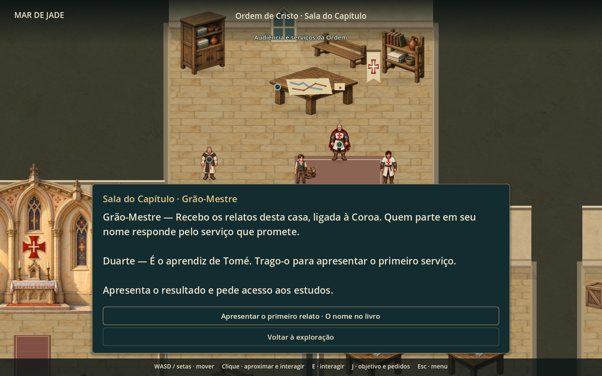
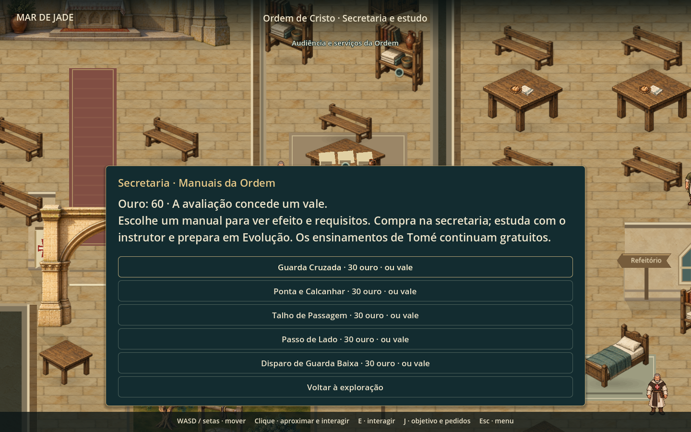

# Liderança, missões e estudos da Ordem

Atualização de 22/10/2026: o catálogo agora contém as [65 técnicas comuns da Medida, com três graus](tecnicas-medida-completas.md), filtros por manejo/patamar e compra/aprendizado pelo menu. A descrição dos cinco estudos abaixo registra a primeira implementação.

Implementação da proposta aprovada no chat em 20/10/2026. O Grão-Mestre é personagem ficcional de Jade: a casa responde à Coroa, preservando o rei e a trama existentes. Não foi atribuído nome histórico a esse cargo.

## Encontrar a liderança

Depois de relatar o primeiro serviço a Duarte, entra no convento e segue pelo corredor norte da secretaria até à **Sala do Capítulo**. O caderno oferece acompanhamento da audiência. Saves anteriores à introdução nova podem apresentar o serviço já concluído da casa ou do socorro.

O Grão-Mestre tem traje próprio, manto vinho, cabelo e barba grisalhos e insígnia da Ordem. Duarte aparece na apresentação inicial. O comendador também recebe relatos e mantém os serviços durante as visitas posteriores à viagem; nessa situação o Grão-Mestre e Duarte não ficam presentes nem deixam interações sobre personagens ausentes.

A sala tem mesa de conselho, mapa de rotas, carta selada, arquivo, assentos, estandarte e janela. O acesso é percorrido pelo mesmo sistema físico de navegação do convento. A câmera mantém os interlocutores visíveis sobre o painel.

## Missões

| Missão | Ações | Resultado |
| --- | --- | --- |
| O nome no livro | Apresentar o primeiro serviço à liderança, com recomendação de Duarte | Autoriza os estudos; o protagonista continua aprendiz de Tomé |
| A carga da Ordem | Ler o registro do arquivo, caminhar até o manifesto do pontão nascente e ouvir a destinatária da Ribeira; regressar para apresentar a conclusão | Duas caixas foram entregues diretamente à enfermaria, com recibo. 40 ouro e 25 XP, uma vez |
| A medida do serviço | Na armaria, iniciar o exercício; alcançar a casa dourada, acertar um golpe e responder de frente com Bom ou Perfeito | Um vale de estudo e 25 XP na primeira conclusão |

O relato da carga exige as três evidências. Acusar sem sustentar a conclusão recebe correção e permite rever o relato. O comendador pode encerrá-lo. O objetivo acompanhado muda de destino a cada etapa, e o pedido pendente aparece antes da partida.

O exercício tem recursos emprestados e solução para os cinco manejos. Não exige Perfeito. Pode ser interrompido por R / Select, não avança o evento principal e retorna ao mesmo compromisso no convento. Não gasta ou restaura diretamente os recursos pessoais; a restauração por subida de nível no Normal continua sendo a regra já existente. Repetir a conclusão não concede outra recompensa. As tarefas da cozinha e as missões antigas continuam independentes.

## Comprar, estudar e preparar

Na **secretaria ou estudo**, consulta o catálogo e escolhe um manual para ver efeito e requisitos. Cada manual custa **30 ouro**; o vale da avaliação substitui o pagamento de uma aquisição. A confirmação é explícita e o cancelamento invalida a proposta anterior.

Na **armaria**, escolhe “Estudar um manual adquirido”. É necessário ter o fundamento correspondente de Tomé, estar recuperado e ter concluído a avaliação. O manual adquirido fica registrado separadamente da técnica conhecida. Aprender preserva as vagas já preparadas; abre Evolução para escolher onde equipar a técnica.

Conhecimento já recebido de Tomé não é cobrado novamente. As quatro técnicas de fogo continuam gratuitas e não são retiradas dos saves existentes. Compra e aprendizado não concedem patamar de cultivo, nível ou domínio automático.

| Estudo | Alento | Efeito executável |
| --- | --- | --- |
| ES09 · Guarda Cruzada | 7 | Primeiro golpe físico da frente ou lado direito tem 30% menos dano residual; uma ocorrência até o próximo turno |
| LA09 · Ponta e Calcanhar | 7 | Ataque a até duas casas, seguido de passo lateral legal |
| MC09 · Talho de Passagem | 8 | Ataque de contato e passo lateral; primeiro golpe da antiga frente tem +10% residual até o próximo turno |
| PU09 · Passo de Lado | 7 | Uma casa livre com custo de movimento e proteção de 20% da antiga frente; sem ataque ou timing ofensivo |
| FO10 · Disparo de Guarda Baixa | 9 | Tiro a até três casas; Bom/Perfeito faz inimigo comum de arma física gastar a próxima ação recompondo a pega. Chefe recebe -10% no próximo ataque físico |

Proteções dos estudos melhoram com o grau da técnica. Desarme tem proteção temporária contra reaplicação imediata, não destrói equipamento e não se aplica a animais sem arma ou ataques marcados como projeção. Previsão e execução usam os mesmos cálculos, incluindo o desconto da passiva de primeira técnica quando elegível.

**Adaptação registrada:** FO10 exigia Circulação/C03-M02 na ficha ampla v2. Nesta implementação aprovada, entra como estudo introdutório de Fundamento da Medida, após audiência e avaliação. O corpus externo foi preservado; esta é a regra do recorte jogável de Jade. Os estudos de outras tradições e os demais requisitos posteriores não foram liberados. Não foram transformados os exercícios C01-DEMO em técnicas aprendidas.

## Arte e implementação

Arte produzida com `image_gen` integrado, mantendo os PNGs e o alpha originais. Prompts e arquivos:

- Grão-Mestre: [prompt](../assets/art/npcs/lisbon/order-house/grandmaster-generation.json), [atlas](../assets/art/npcs/lisbon/order-house/order-grandmaster-v1.png); 16 poses de exploração.
- Instrutor no combate: [prompt](../assets/art/combat/portugal/order-instructor-generation.json), [atlas](../assets/art/combat/portugal/order-instructor-v1.png); nove poses com apoios de arma derivados da composição usada como referência.
- FO10: [prompt](../assets/art/skills/portugal/FO10-generation.json), [ícone](../assets/art/skills/portugal/FO10-v1.png).

Os estudos aproveitam as poses e sons do manejo; FO10 usa o disparo apoiado e seu som correspondente. A avaliação renderiza o instrutor da Ordem, com malha e tabardo, e não Tomé.

Estados novos usam campos opcionais de flags e o acompanhamento de pedidos existente. Saves sem esses campos continuam válidos. Validação recusa dependências inválidas de vale/avaliação e recompensas, antes de alterar o estado em memória. Compra valida conhecimento, autorização, recuperação, fundamento, ouro ou vale; preço e aquisição são confirmados novamente antes da cobrança.

## Verificação

Validação concluída: 1.284 verificações em 18 suítes, incluindo 58 de liderança, 94 de estudos e 197 de trajes da Ordem. Os dois testes finais confirmam acesso à sexta ação de arma de fogo pelo teclado e pelo ciclo do controle. O capítulo completo também passou pelos 17 cenários da sua suíte.

Capturas adicionais: [avaliação com o instrutor](ordem-avaliacao.png) e [seis ações de arma de fogo, incluindo FO10](ordem-estudo-fogo-combate.png).

As suítes específicas cobrem caminhada real até a sala e aos três pontos da investigação, audiência, relato correto e incorreto, compra sem confirmação, confirmação antiga, cancelamento, pausa, aprendizado remoto, recompensa única, vale, repertório preservado, save/load e retorno à casa. O combate exercita os cinco estudos, previsões, terreno bloqueado, movimento, direções de proteção, desarme e imunidade, chefes, passivas e solução da avaliação com cada arma.

`tools/capture_order_leadership.gd` gera imagens com o renderer real, em perfil de QA isolado. As posições das capturas são fixtures visuais; a navegação é verificada separadamente pelos testes com caminhada. Clareza espontânea, preferência pelo preço e ritmo da sequência ainda dependem de uma partida natural.
