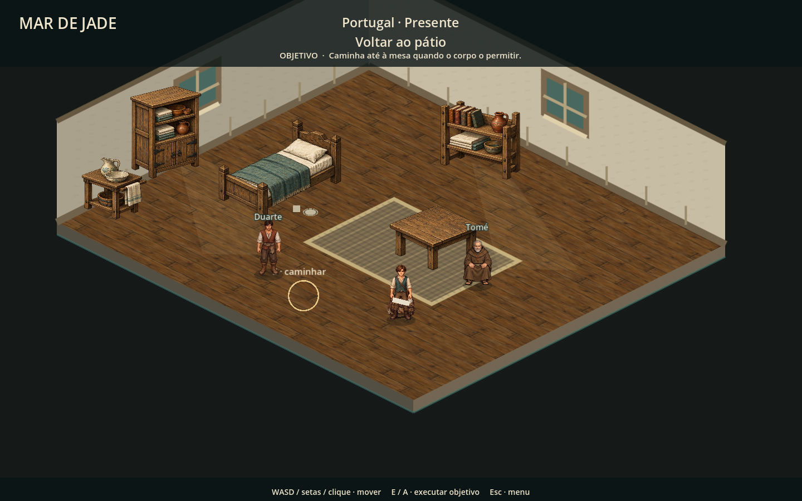

# Mesa, paredes e integração visual

16/10/2026 — continuação do acabamento de Portugal. Escopo: apresentação das refeições, paredes do abrigo, sombras de contato e desgaste localizado da praça. Não altera o roteiro, as escolhas, os combates nem o formato dos saves.

## Mudanças

- O menino e Tomé sentam-se nas bordas opostas da mesa, com bancos ilustrados. O menino usa um assento mais alto para alcançar o tampo. Ao rever a cena, altura e ordenação retornam ao estado inicial.
- Tigela com comida, copo de barro, pão e pano substituem as formas geométricas da mesa. A tigela carregada fica abaixo do rosto. A comida continua aparecendo sobre a mesa somente após a ação prevista no roteiro.
- No cais, a mesa deixou de usar escala 0,7. Os assentos foram reposicionados para adultos, e a louça passou a ser desenhada por cima do tampo, em vez de ficar parcialmente escondida atrás dele.
- Na recuperação, um banco baixo apoia a tigela e o copo junto à cama.
- Paredes com textura de reboco em shader, pequenas fissuras, embasamento de pedra em fiadas alternadas e madeira nos encontros. As janelas receberam sombra no vão e peitoril com espessura.
- Personagens, cama, mesa e mobiliário adicional compartilham sombras de contato suaves. As direções de olhar da abertura adulta acompanham a conversa.
- A praça ganhou marcas pontuais de uso, pequenas fissuras e folhas junto das árvores/banco. O muro baixo tem fiadas e capeamento, sem alterar os percursos ou adicionar colisores.

## Antes e depois

### Mesa — antes

### Mesa — depois

### Paredes — antes

### Paredes — depois

### Refeição no cais

### Recuperação

### Praça

## Verificação

289 verificações sem falhas: abertura 26, integração do abrigo/refeição 41, praça 40, promessa 25, abertura adulta 19, percurso completo 41, transições/checkpoints 15, encerramento de combate 27 e inventário 55.

O percurso completo usa caminhada com física e interação pelo viewport. `tests/shelter_finish.gd` verifica os seis recortes do atlas, transparência, cache, instalação única da decoração, colisores preservados, altura dos assentos e transferência da comida para a mesa. As capturas foram renderizadas no Godot/OpenGL, sem erros no log final. Os testes headless emitem o aviso de certificados Windows do ambiente. Não houve playtest humano prolongado.

## Arte e reprodução

Novo atlas: [dining-v1.png](../assets/art/portugal-v2/dining-v1.png). Criado com a geração integrada de imagens, usando o mobiliário existente como referência de estilo. Contém duas orientações de banco, tigela, copo, pão e pano. [Prompt completo e origem](dining-generation.json).

`tools/build_dining_assets.py` descreve recortes por alpha sem alterar os pixels da fonte. `tools/capture_campaign_maps.gd` reproduz as capturas. Os bancos e utensílios são partilhados por `scripts/chapter/dining_art.gd`; as paredes são código/material nativo do projeto.
