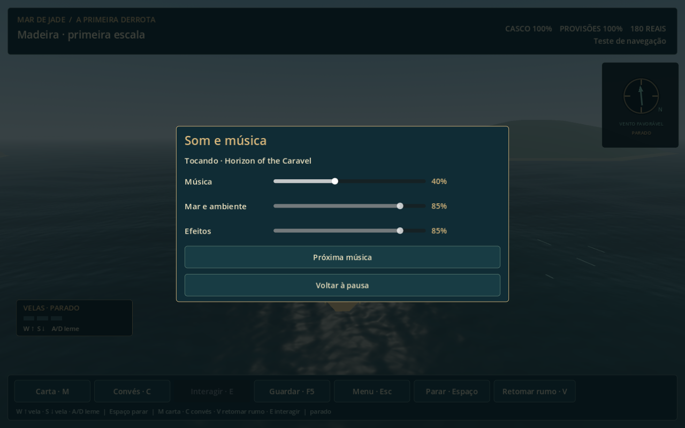
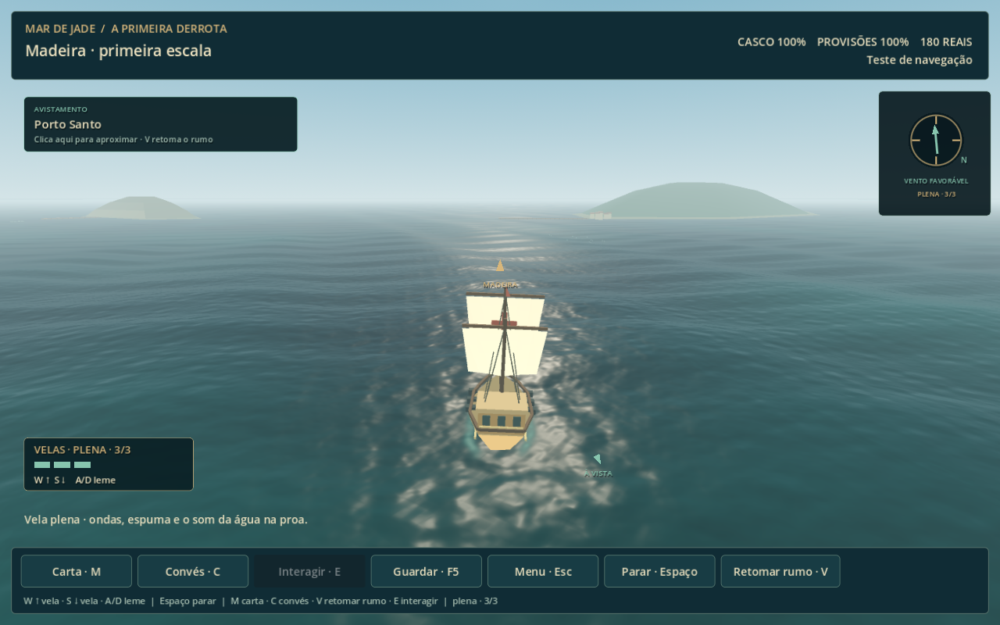

# Navegação — trilha, ondas e som do casco

Refinamento iniciado em 15/10/2026, após aprovação dos controles pelo leme e da câmera com horizonte. O acesso atual é **Navegar para a Madeira** no fim de Portugal ou **Continuar viagem guardada** na entrada; o estudo isolado usa F6 em `scenes/navigation/voyage.tscn`.

A [revisão visual de 16/10](navegacao-mar.md) acrescenta quatro ondas, reflexos e espuma contínua e já está integrada à saída de Portugal nesta cópia. O acesso atual é pelo fim da campanha ou por uma viagem guardada; os atalhos internos de teste foram retirados do menu do jogador.

## Trilha fornecida pelo jogador

As seis músicas foram copiadas para o projeto, preservando os MP3 originais de Downloads:

1. Horizon of the Caravel
2. Sails Against the Horizon
3. Salt on the Bowsprit
4. Where the Map Ends
5. Vamos ao Mar
6. O vento no peito

A sequência tem cerca de dezoito minutos de material e se repete ao terminar. Há entrada suave e transições de cinco segundos entre faixas, com dois reprodutores e curva de potência constante. O volume de reprodução de cada faixa foi ajustado a partir de análise de loudness para reduzir diferenças entre músicas; os arquivos não foram regravados. A trilha continua nos menus e no convés, com redução suave durante diálogos, pausa e combate. Trocar de fase não reinicia a música.

**Esc → Som e música** abre os volumes independentes de **Música**, **Mar e ambiente** e **Efeitos**, além de **Próxima música**. Em batalha, o painel está nas ordens. Música em zero silencia apenas a trilha. As preferências ficam em `user://navegacao-audio.cfg`, separadas dos saves. Fechar a viagem encerra reprodutores e remove seus buses de áudio; o menu de Portugal mantém seu funcionamento.

## Mar e embarcação

O mar próximo usa uma malha subdividida de 4096 unidades ao redor da embarcação. Três ondas somadas deformam sua superfície; o restante do oceano usa uma superfície leve até o horizonte. A malha acompanha a viagem e as fases das ondas usam posições do mundo, mantendo continuidade ao mudar de rumo. Em mar pesado, a ondulação e a espuma crescem.

O navio sobe, inclina a proa e balança de lado conforme o mesmo campo de ondas. A câmera permanece nivelada. Restos e barcos próximos também flutuam. Espuma aparece junto à proa; o rastro usa posições e rumos anteriores, para acompanhar as curvas em vez de girar todo junto do navio. Ao encontrar uma crista, a água produz um impacto no casco; com andamento, o encontro também lança gotas nas laterais. Parado, as batidas são mais suaves. Pausa e diálogos suspendem a animação do mar e do barco.

Camadas originais sintetizadas localmente:

- mar aberto e vento contínuos;
- água passando pela proa, crescendo com a velocidade;
- pancadas e refluxo da onda junto ao casco, com posições à esquerda/direita;
- cordame e tecido das velas;
- aves, madeira e sinal de descoberta já existentes.

Os loops receberam bordas suavizadas para evitar estalos ao repetir. Água/vento/rigging mudam com andamento, perigo, convés e pausa. O convés recebe ambiente mais abafado. Descobertas, canhões e sons da abordagem usam o volume de efeitos; mar, casco e velas usam o de ambiente.

[Prévia de 18 segundos com áudio capturado no Godot](navigation-atmosphere.mp4). O trecho usa um excerto de Horizon of the Caravel, a partir de 35 segundos, junto da mixagem real de mar e casco.

## Validação e arquivos

- `tests/navigation_atmosphere.gd`: **37 verificações em OpenGL**, sem falhas, cobrindo as seis faixas completas, transição manual e automática, volumes e persistência, estéreo/intervalo de ondas, tecido, filtro do convés, flotação, espuma, impacto parado, horizonte estável, pausa, retorno a um checkpoint anterior, painel de som e limpeza dos buses.
- `tests/navigation.gd`: **88 verificações headless e 89 em OpenGL**, sem falhas, incluindo trajetória, controles, atalhos, descobertas, perigo, saves, encontro naval, boss e abordagem com retorno ao mar.
- `tests/name_entry.gd`: **23 verificações**, sem falhas.
- Prévia real: 1280×800, 30 fps, áudio estéreo 48 kHz. Pico medido no MP4: **−10,2 dBFS**, sem saturação nesse trecho. A mixagem e a sensação das ondas permanecem abertas ao playtest do jogador.

O ambiente de QA emitiu os avisos já conhecidos de certificados e escrita no cache de shaders. Não houve falhas finais de GDScript ou de shader. A apresentação usa geometria e materiais procedurais; não foram criados executáveis.

Implementação: `scripts/navigation/voyage_audio.gd`, `voyage_sea.gd`, `voyage_perspective.gd`, `voyage.gd` e `assets/shaders/navigation_perspective_ocean.gdshader`. Sons reproduzíveis em `tools/build_navigation_audio.py`; procedência e picos em `assets/audio/navigation/sources.json`. Playlist, durações, ganhos e hashes em `assets/audio/navigation/music/playlist.json`; cópia reproduzível em `tools/prepare_navigation_music.py`. Os testes de volume usam arquivos isolados em `tests/`.
