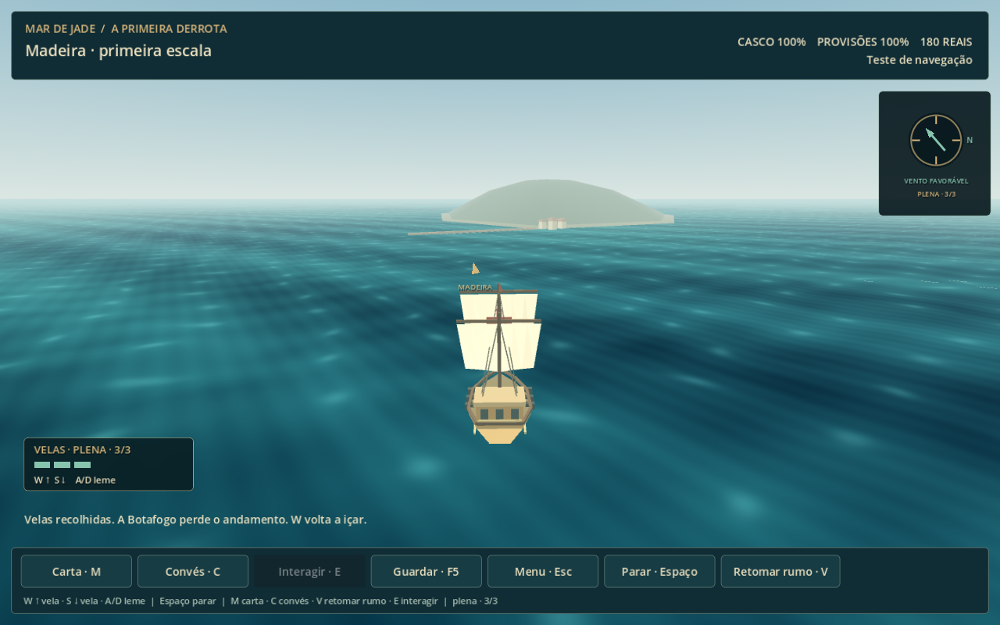

# Navegação — leme, três velas e horizonte

Revisão após o playtest de 15/10/2026. O jogador identificou deriva excessiva, W preso ao norte do mapa, velocidade baixa e uma vista demasiado vertical. Escolheu experimentar uma câmera atrás e acima do barco; para as velas, escolheu W/S por níveis, mantendo o andamento ao soltar a tecla.

## Experimentar

`Jogar.cmd` → terminar Portugal → **Navegar para a Madeira**, ou **Continuar viagem guardada** na entrada. No editor, F6 em `scenes/navigation/voyage.tscn` abre o teste separado. O barco começa com velas recolhidas. Cada toque em W sobe um nível; cada toque em S desce. Setas cima/baixo e impulsos verticais do analógico têm o mesmo efeito; é preciso retornar o analógico ao centro entre impulsos.

| Estado | Andamento relativo | Uso |
|---|---|---|
| Parado | 0 | Velas recolhidas, desaceleração curta |
| Manobra · 1/3 | 45% | Observar, aproximar e atracar |
| Viagem · 2/3 | 100% | Andamento normal, mais rápido que a versão anterior |
| Plena · 3/3 | 160% | Travessia rápida |

**A/D ou esquerda/direita** comandam o leme em relação à proa. Soltar o leme mantém o rumo; soltar W mantém a vela. Não existe marcha à ré: S recolhe vela até parar. **Espaço / RB** para a embarcação durante a exploração. Atalhos 1/2/3 selecionam diretamente a vela em exploração. Em batalhas, W/S e A/D continuam iguais; Espaço abre ordens e 1/2/3 escolhem o alvo dos canhões.

A velocidade acompanha a direção da quilha, eliminando a deriva lateral acumulada. A parada da vela plena leva menos de um segundo nos parâmetros básicos. A aceleração mantém uma transição curta; o piloto melhora manobra e andamento. Não é uma simulação histórica de inércia: os parâmetros privilegiam resposta e exploração.

A carta e os cartões de avistamento continuam oferecendo condução automática. O piloto reduz andamento ao chegar e recolhe a vela dentro do alcance de interação. A/D ou um novo toque em W/S devolvem o leme ao jogador. Convés, desembarque, fim de batalha e carregamento retornam com velas recolhidas.

## Perspectiva

A viagem usa Camera3D em perspectiva num SubViewport independente. A câmera fica atrás e acima da Botafogo, acompanha o rumo com suavização e olha adiante em um ângulo de aproximadamente 14°. Céu e horizonte permanecem visíveis. A bússola gira o norte em relação à proa. O clique no mar projeta um raio sobre o plano navegável; clicar no céu não cria um rumo.

Navio, mastros, velas, costa, portos e sinais ambientais usam geometria procedural simples. As velas recolhem visualmente conforme o nível; neblina dá profundidade às costas e embarcações distantes. O mar tem shader próprio em coordenadas do mundo. Esta é uma apresentação para avaliar câmera e condução; o acabamento artístico ainda é provisório. A geometria de colisão e os dados de descobertas continuam sendo os da carta existente.

A carta, o convés, os portos a pé, os encontros navais e a abordagem mantêm suas apresentações próprias. A câmera com horizonte é usada na viagem livre. Avistar fisicamente uma silhueta à distância não revela automaticamente sua identidade ou rota na carta.

## Validação

O ensaio `tests/navigation.gd` verifica o leme relativo, manutenção da vela ao soltar W, três velocidades, parada, giro sem deriva, projeção e seleção do mar, horizonte, carta, aproximação, recuperação, compatibilidade de saves e preservação do progresso de Portugal. Vitória naval comum e boss são exercitadas pela nova função de leme; a abordagem tática retorna ao mar.

Resultados: **88 verificações headless e 89 em OpenGL**, sem falhas. O render OpenGL emitiu avisos ambientais de escrita no cache de shaders e certificados; as capturas foram geradas e inspecionadas. Regressões do menu inicial (**23 verificações**) e do capítulo completo (**31**) também passaram.

O percurso direto em vela de viagem mediu **371 segundos (6min11s)**; a primeira pista surgiu em **9,8s** na simulação direta. Atividades e desvios acrescentam tempo. O balanceamento das velas e a sensação da câmera precisam do próximo playtest do jogador.

Arquivos principais: `scripts/navigation/voyage_perspective.gd`, `voyage_model.gd`, `voyage.gd`, `voyage_view.gd`, `naval_battle.gd` e `assets/shaders/navigation_perspective_ocean.gdshader`. Saves anteriores continuam carregando; não é preciso iniciar novamente a campanha.
