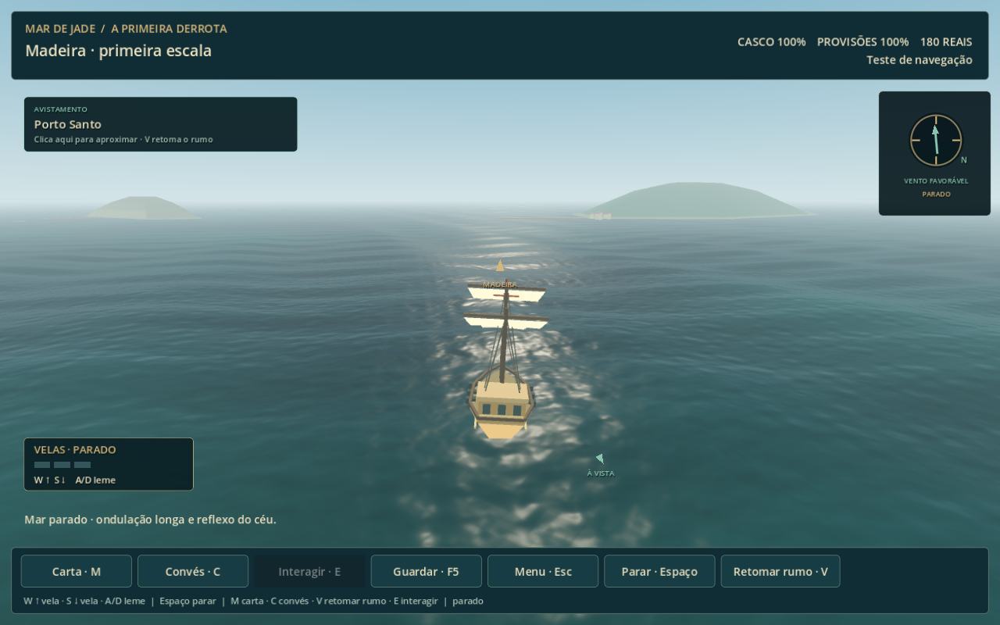
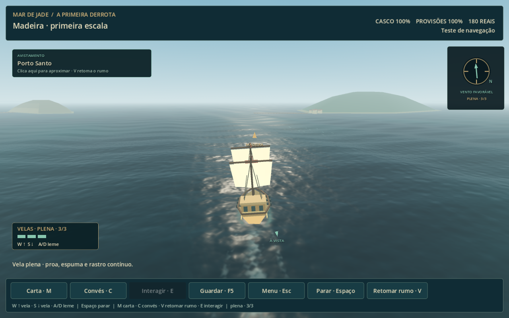
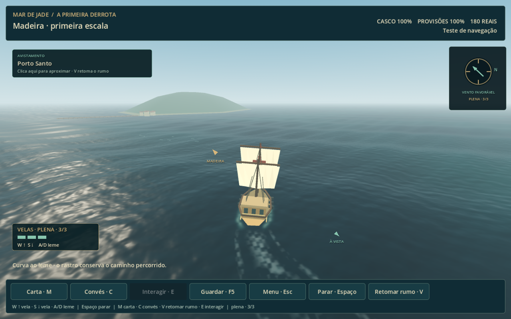
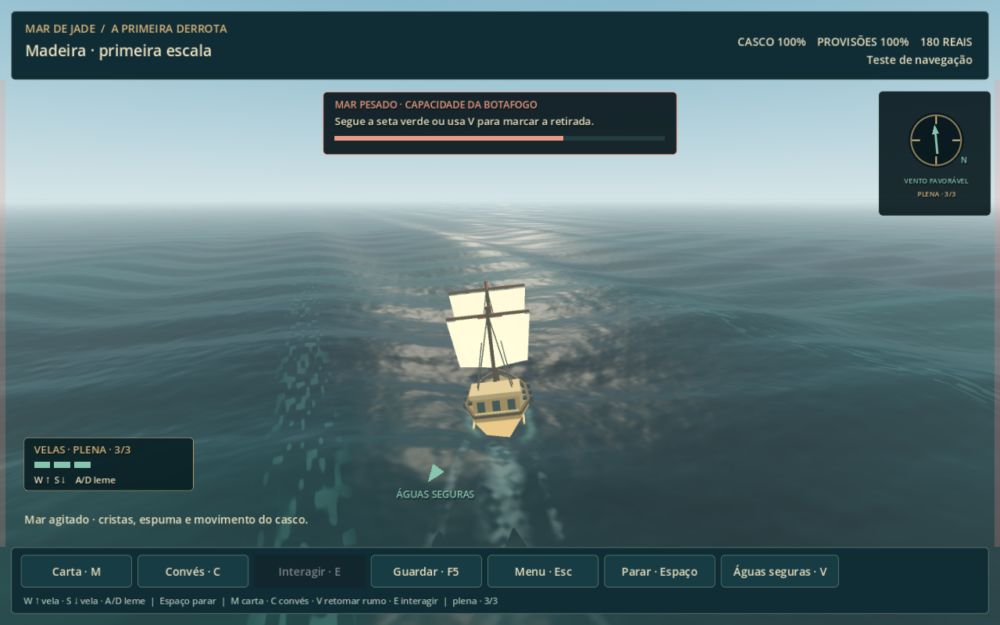

# Navegação — refinamento do mar

Implementado em 16/10/2026 no projeto `GitHub/mar-de-jade`, com Godot 4.5.1 e renderizador Compatibility, e reunido com as correções da campanha no repositório principal `Documents/GitHub/mar-de-jade` na mesma data. Entrar pelo fim de Portugal em **Navegar para a Madeira**, continuar uma viagem guardada, ou abrir `scenes/navigation/voyage.tscn` no editor. Os controles pelo leme e os três níveis de vela continuam disponíveis.

## Integração com a campanha

A revisão do mar estava na outra cópia do projeto e em arquivos de preparação dentro de `.qa-runtime/ocean-refinement`, mas ainda não estava nos scripts e shaders usados por `Jogar.cmd` desta pasta. O embarque já chamava a cena correta; essa cena carregava os arquivos anteriores de 15/10.

Foram integrados os três módulos `voyage_perspective`, `voyage_sea` e `voyage_wake`, os dois shaders e os respectivos testes e recursos. Os cinco arquivos de implementação foram comparados por SHA-256 com a cópia de origem. A interface atual e a correção de resolução dos combates foram preservadas. O modelo e o formato dos saves são os mesmos: viagens existentes usam a apresentação atualizada ao reabrir o jogo.

O novo `tests/navigation_campaign_entry.gd` aciona o botão real do fim do capítulo e verifica que a viagem da campanha recebe o oceano de quatro ondas, o shader de espuma contínua, a câmera com horizonte, as seis músicas e o personagem com suas técnicas. A captura abaixo foi feita nessa rota, com autosave desligado e hashes dos saves reais conferidos antes e depois.

Validação desta integração: **153 verificações sem falhas** — entrada pela campanha (12), mar em OpenGL (16), áudio e atmosfera em OpenGL (37) e navegação headless (88). As capturas de mar parado, andamento, curva e mar pesado foram geradas novamente nesta cópia.

[Gravação real com áudio — 24,5 segundos](navigation-ocean.mp4): barco parado, aceleração até vela plena, curva e parada até a espuma se dispersar. Captura em 1280×800, 30 fps, estéreo 48 kHz; pico de áudio do MP4 medido em −10,8 dBFS.

## Ondulação e luz

Quatro ondas combinam ondulação longa e movimentos menores em direções diferentes. Uma componente harmônica torna as cristas menos arredondadas. Os parâmetros são compartilhados entre o shader e o cálculo de altura e inclinação do navio; as posições do mundo mantêm a fase contínua durante a viagem. O mar pesado amplia o mesmo campo de ondas.

A superfície próxima continua sendo uma malha de 4096×4096 unidades, com 160 subdivisões em cada eixo. Pequenas ondulações irregulares afetam as normais e perdem detalhe com a distância para reduzir cintilação. O material recebe luz especular do sol e radiância do céu, com variação de cor e intensidade conforme a direção de observação e a altura da onda. São reflexos de iluminação e ambiente; não há captura do barco na água.

O horizonte usa cores de céu e névoa compatíveis com a água. A câmera conserva a posição aprovada e permanece nivelada enquanto o navio balança.

## Água junto ao casco

A espuma se abre na proa e acompanha a largura do casco nas laterais. Os impactos nas cristas acionam o som existente e um pulso de espuma no mesmo evento; em movimento também lançam gotas, que desaparecem ao reencontrar a superfície.

Três faixas de espuma usam as posições e os rumos anteriores da embarcação. O rastro conserva o percurso durante as curvas, se alarga, se fragmenta e perde intensidade com a idade. A amostragem é limitada a vinte posições por segundo, 160 pontos e sete segundos de histórico. A embarcação parada não gera rastro de avanço.

Pausas congelam a fase visual. Teleportes e retorno a checkpoints anteriores limpam o histórico para não criar uma faixa entre posições distantes nem repetir um impacto antigo. As regras de navegação, consumo e progresso permanecem no modelo existente.

## Validação

- `tests/navigation_ocean.gd`: 16 verificações em OpenGL, sem falhas. Compara a derivada das ondas com diferenças finitas, confere parâmetros CPU/GPU, ausência de rastro parado, malhas contínuas, limites do histórico, curva real pelo leme, parada e dispersão, pausa, teleporte, checkpoint anterior, flotação em mar pesado, horizonte e preservação do progresso da campanha.
- `tests/navigation_atmosphere.gd`: 37 verificações em OpenGL repetidas, sem falhas, incluindo as seis músicas, volumes, impactos, espuma, flotação e pausa.
- `tests/navigation.gd`: 88 verificações headless repetidas, sem falhas, incluindo trajeto, controles, descoberta, saves, perigo, combate naval, boss e abordagem.

Em cem amostras na RTX 3060, o viewport 3D da navegação mediu em média **2,68 ms de GPU** e **0,50 ms de CPU** pelo RenderingServer. A medição inclui toda a cena desse viewport, não apenas o material da água, e não equivale ao tempo total de quadro do jogo. Capturas e gravação foram inspecionadas para conferir o horizonte, os reflexos, as curvas e a dispersão; sensação e preferência visual continuam dependentes do playtest do jogador.

Arquivos principais: `scripts/navigation/voyage_sea.gd`, `voyage_wake.gd`, `voyage_perspective.gd`, `assets/shaders/navigation_perspective_ocean.gdshader` e `navigation_wake.gdshader`. `tools/record_ocean.gd` reproduz a gravação com configurações de áudio isoladas e autosave desligado. Não foram criados executáveis.
