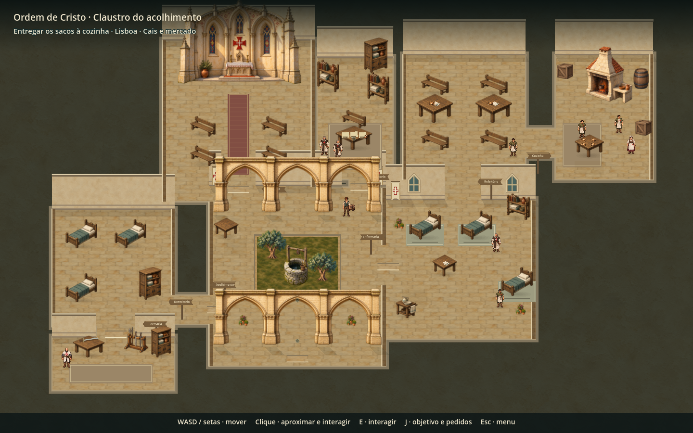
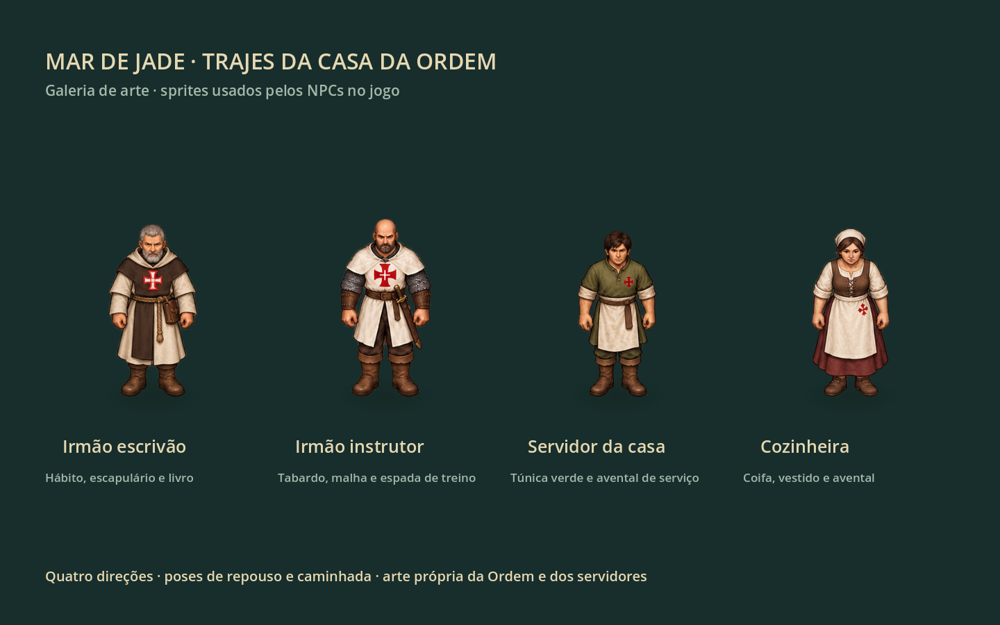
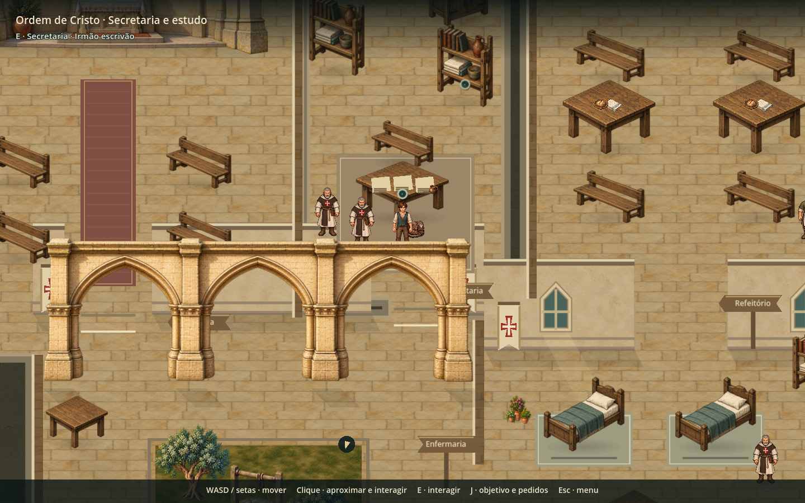
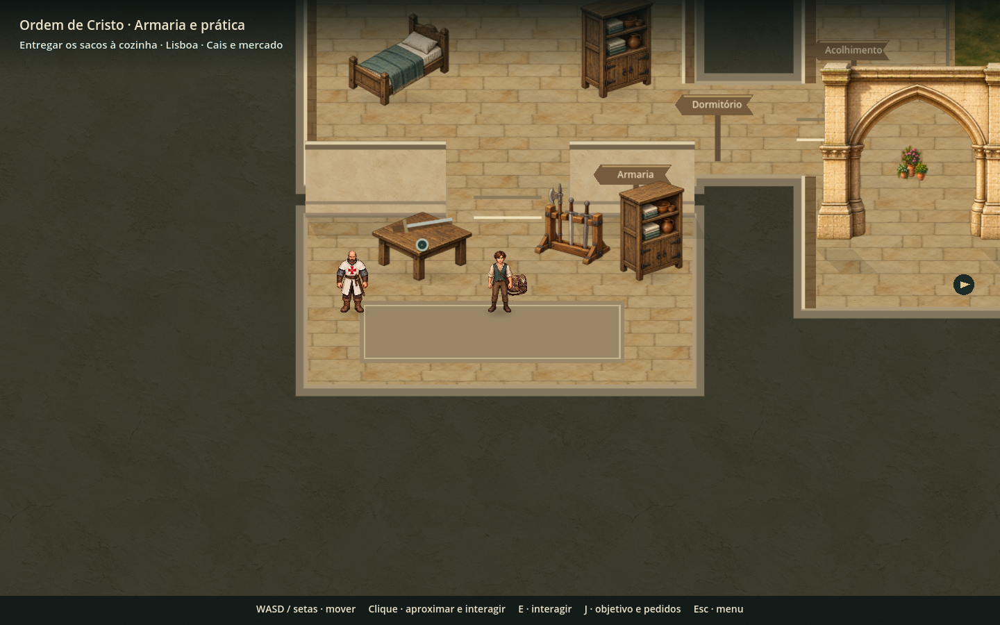
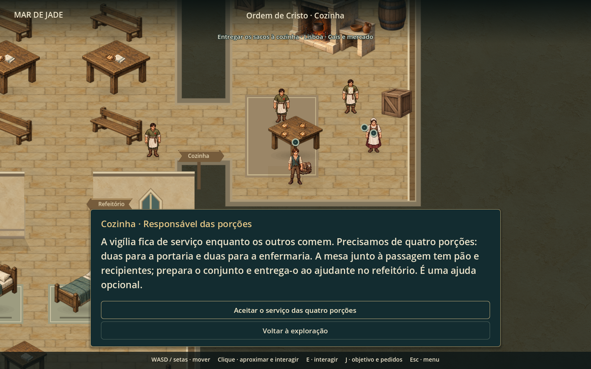

# A casa da Ordem como lugar de jogo

O interior passa a reunir atividades em cômodos reconhecíveis. A secretaria fica entre a capela e o refeitório; a armaria liga-se ao dormitório. Os percursos antigos da cisterna, enfermaria e entrada continuam acessíveis.

## O que fazer

| Lugar | Uso |
| --- | --- |
| Quadro de serviços e secretaria | Consultar compromissos e oferecer ajuda à cozinha |
| Estudo | Consultar técnicas e preparar o repertório existente |
| Armaria | Conferir equipamento e abrir prática com o manejo equipado |
| Cozinha e mesa de preparo | Aceitar o pedido e separar quatro porções |
| Refeitório | Entregar as porções ao ajudante da vigília |
| Enfermaria | Conferir a reserva pessoal de itens |
| Dormitório | Organizar o equipamento |
| Capela | Registar um propósito no caderno |

**A mesa de quem fica** é um novo serviço opcional. A cozinha explica a necessidade: duas pessoas na portaria e duas na enfermaria. O jogador prepara quatro porções e confirma a entrega com o ajudante do refeitório. Separar só duas mantém a etapa e explica o que falta. A conclusão concede uma ração e 25 XP uma única vez. O caderno e a indicação de destino acompanham a etapa; a partida avisa se o pedido estiver pendente. Não bloqueia a história.

A prática usa a arena do pátio com recursos emprestados. Sair ou concluir devolve o jogador ao mesmo compromisso no interior. Não concede aprendizagem, XP ou recursos por repetição; requer o fundamento aprendido e ausência de ferimento narrativo.

Quatro responsáveis ocupam os postos e três ajudantes percorrem trajetos curtos de trabalho. Param perto do jogador e durante as interações. Papéis, material de treino, mantimentos e porções distinguem as mesas. Os modelos e a arquitetura mantêm a arte própria do projeto.

Os funcionários agora usam quatro famílias de sprites próprias: irmão da Ordem (hábito claro, escapulário castanho e cruz), instrutor (tabardo, malha e espada de treino), servidor (túnica verde e avental) e cozinheira (coifa, vestido e avental). O irmão da portaria e a responsável dos mantimentos no adro seguem a mesma identidade visual. As crianças do acolhimento mantêm as roupas infantis.

Os PNGs originais e os prompts completos estão em [order-house/generation.json](../assets/art/npcs/lisbon/order-house/generation.json). Foi usada a ferramenta integrada de geração de imagens, com a arte existente de Duarte como referência de estilo. `tools/build_order_house_frames.py` mede os quadros e os apoios dos pés, sem alterar os pixels ou a transparência das artes. São 64 poses de exploração indexadas; a folha do irmão inclui poses adicionais de descanso que não são usadas nesta integração.

## Referência e limites

Hero’s Adventure orientou a organização por lugares de atividade e responsáveis. Foram consultados o estudo local em `reference-study/heros-adventure`, os dossiês de mapas e NPCs da pesquisa do projeto e a [apresentação do próprio desenvolvedor](https://www.reddit.com/r/Games/comments/17yzpca). O estudo local contém componentes visuais, não uma planta interior reconstruída: esta planta e seus serviços são uma adaptação original para Mar de Jade.

## Verificação

`tests/order_house_hub.gd` percorre fisicamente os dez pontos, exercita aceitação, preparação, entrega, persistência e recompensa única, além de verificar o retorno dos sinais de conclusão e interrupção da prática. As capturas em `tools/capture_order_house_hub.gd` usam um perfil temporário e não gravam no save pessoal. O enquadramento geral da planta usa zoom de documentação; as vistas próximas usam o zoom de exploração.

Resultado: **464 verificações passaram em oito suítes** — interior (47), convento (62), vida da casa (60), primeiro serviço (60), pedidos opcionais (71), interface (34), capítulo completo (73) e desenvolvimento (57). O capítulo completo atravessou as 17 cenas previstas. Fixtures geradas pelos testes foram restauradas ao estado anterior à alteração.

Depois da integração dos trajes: **265 verificações passaram em três suítes** — arte e presença dos nove funcionários do interior (158), atividades do interior (47) e vida da casa nas duas idades (60). A galeria renderizou os quatro trajes e as 64 poses com o renderer real; as capturas da planta e dos cômodos foram atualizadas. Os saves de QA foram isolados dos dados pessoais.

Validação humana de ritmo e de clareza espontânea continua a depender de uma partida.
