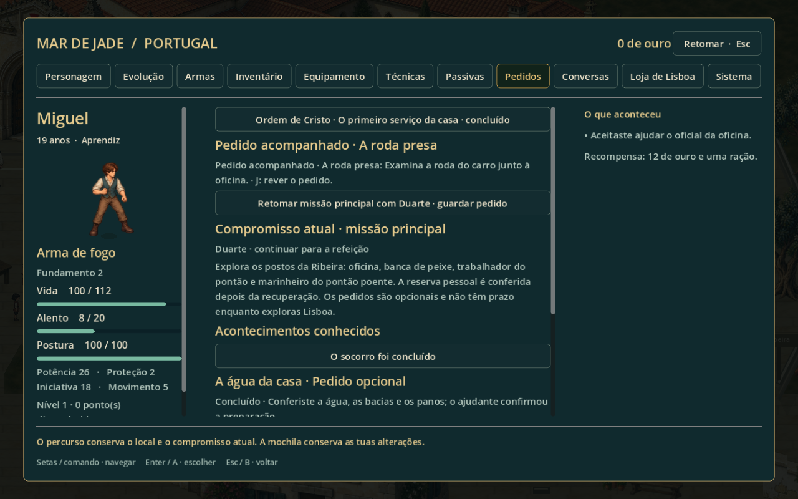
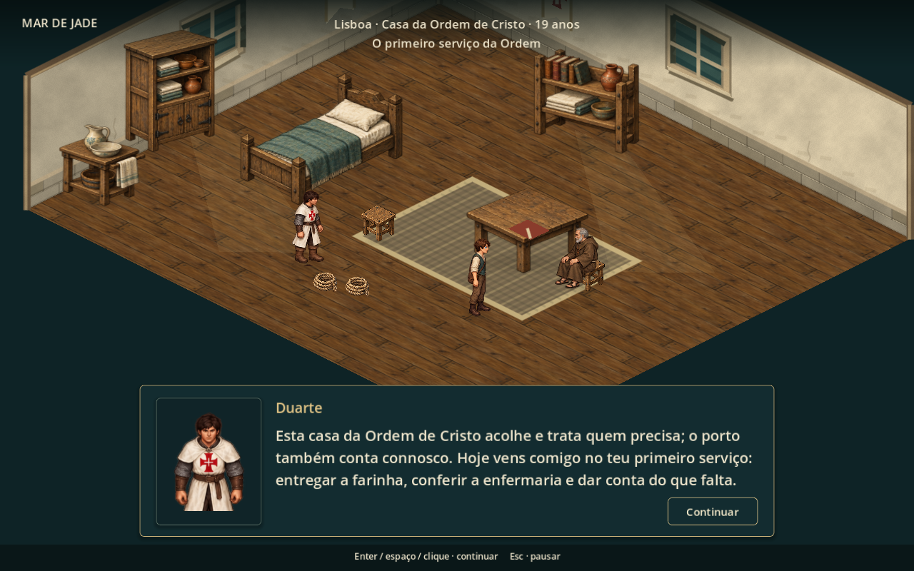

# Primeiro serviço da Ordem — abertura adulta

Reorganização solicitada após o teste do jogador. A infância e o encontro posterior com Leonor permanecem no percurso. A fase adulta começa com Duarte explicando a função da casa da Ordem de Cristo em Lisboa e o serviço pelo qual o protagonista vai responder.

## Percurso jogável

1. **Compromisso e entrega.** Duarte apresenta o serviço na primeira fala da abertura adulta: farinha, reserva da enfermaria e relato do trabalho. A entrega à cozinha continua com a escolha de conservar os sacos secos.
2. **Arma e fundamento.** No pátio, Tomé oferece o primeiro manejo antes da saída ao cais. A escolha usa a tela existente com as cinco armas, suas características e prática opcional. Arma de fogo continua ensinando as quatro técnicas. O aprendizado posterior à recuperação vira retomada do manejo, sem exigir outra escolha inicial nem dar outra arma gratuitamente.
3. **Reserva da Ordem.** Duarte apresenta duas alternativas reais: gibão reforçado e ligadura, ou capa e água. A descrição informa os efeitos. O traje é equipado; os consumíveis permanecem na sacola. A entrega ocorre uma única vez, não cura e não pode ser repetida trocando de pacote.
4. **Preparar o repertório.** Antes de seguir, há acesso explícito às seis vagas ativas e à conferência do equipamento. Fechar a ficha volta ao preparo, sem avançar a missão.
5. **Serviço na enfermaria.** O jogador entra pela portaria, atravessa o claustro e verifica água e panos. Escolhe por onde começar; o serviço registra a conferência de ambos. O indicador e o caderno apontam a próxima ação. A tarefa cumpre a revisão adulta da casa, evitando oferecer a mesma obrigação novamente como opcional; a lembrança da infância é preservada.
6. **Prestar contas.** É necessário voltar fisicamente a Duarte no pátio. Ele reconhece a reserva conferida e o relato, antes de continuar para o acontecimento do cais.
7. **Primeiro pedido acompanhado.** Depois do socorro, Duarte apresenta a oficina e sua relação com o material usado pela casa. A roda presa continua sendo um pedido opcional, com escolhas de diagnóstico e reparo. É possível ajudar ou seguir para a refeição, sem prazo nem perda do pedido.

O deslocamento até à enfermaria e o regresso ao pátio usam as portas, caminhos e colisões reais. Não há teletransporte no percurso jogável.

## Pedidos mais claros

Ao aceitar um pedido da Ribeira, o caderno passa a acompanhá-lo. O indicador muda conforme a etapa: pessoa que oferece o trabalho, objeto a examinar, responsável pela peça, local do reparo e retorno para concluir. A conta das entregas, reserva de suprimentos e amarra também têm alvos por etapa; a reserva incompleta aponta para o comerciante e, depois de completa, para o trabalhador que a confere.

**Pedidos → Acompanhar este pedido** seleciona outra linha em curso. A próxima ação fica no topo; missão principal e lembranças concluídas são apresentadas separadamente. **Retomar missão principal com Duarte** preserva o estado do pedido e troca a indicação de volta para o compromisso principal. Não exige terminar opcionais para prosseguir.

No pedido acompanhado, Duarte se desloca junto do jogador, comenta o resultado e responde explicitamente quando a ajuda é adiada. O oficial continua responsável por aceitar o reparo e entregar a recompensa. XP finita de pedidos e descobertas é sincronizada no resultado, antes de guardar; reabrir diálogos não repete recompensas.

## Duarte com roupa própria

Foram criados **20 quadros de exploração e nove de combate**, substituindo visualmente o colete civil por sobreveste branca comprida, manto curto, malha e cruz vermelha com centro branco. O retrato usa a mesma arte de personagem. O traje aparece na abertura, na cidade e nas lutas, inclusive em renderização sem o antigo shader de recoloração.

As imagens anteriores foram preservadas como fontes históricas. As bibliotecas agora carregam diretamente `duarte-order-v2.png` e seus metadados. O novo traje não muda atributos nem o equipamento narrativo fixo de Duarte.

Geração: ferramenta integrada de imagens, a partir dos dois atlas anteriores como referência de identidade e poses. Prompts e proveniência em [duarte-order-generation.json](../assets/art/npcs/lisbon/duarte-order-generation.json). `tools/build_duarte_order_frames.py` mede quadros, pés e empunhaduras sem reescrever os pixels.

## Continuidade e teste

A marca da nova introdução é gravada na campanha. Saves anteriores já em andamento conservam seus índices e percurso. Recomeçar o primeiro bloco habilita a introdução; avanços anteriores a outros blocos não são apagados para forçar o novo serviço. Para ver a apresentação completa de Duarte, o percurso deve passar pela abertura adulta. Não houve alteração nos saves pessoais durante a validação.

A sequência mantém os seis marcos principais e seus **400 XP**, suficientes para o nível 4 sem opcionais. A revisão testa a entrega anterior à preparação e o carregamento na enfermaria depois da entrega, preservando os três eventos iniciais que já tinham sido percorridos. Cursores de serviço incompatíveis com a cena e escolhas inválidas de reserva são recusados antes de alterar o estado.

**979 verificações aprovadas em 17 suítes**, contadas sem repetições. Incluem 60 específicas do serviço da Ordem, 73 do percurso completo das 17 cenas, 71 dos opcionais, equipamentos, repertório, navegação, combate e ida/volta entre terra e viagem. O pedido acompanhado foi percorrido por navegação e interações reais, do primeiro diálogo ao reparo e retorno. Foram testadas também a saída voluntária com uma peça ainda pendente e a mudança do indicador de volta à missão principal.

O executor `tools/test_character_development.ps1` usa diretórios exclusivos de QA. As capturas nativas são reproduzidas por `tools/capture_order_first_service.gd`, com salvamento pessoal desativado: abertura, reserva, preparo, enfermaria, oferta do pedido, caderno e combate. A avaliação do ritmo, compreensão espontânea e preferência visual continua dependendo do novo teste do jogador.
